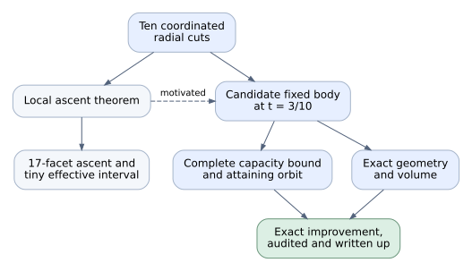

# How the exact HKO improvement was obtained

29 October 2026 · research postmortem · r3 · [review: postmortem_review]

The run produced an explicit convex four-polytope with EHZ systolic ratio
**1.0519141388294875…**, above the Haim–Kislev–Ostrover pentagon-product value
**1.047213595499958…**. The important achievement is the combination: an
explicit body, an exact *global* capacity calculation, an exact volume, and
a readable, checked report with a reproducible companion. A promising orbit
or a floating-point search would not have established that result.

The most useful hindsight is more specific than “start with the answer.”
Once the ten-cut family had been found, the later finite-body theorem did
not logically need the full local-variation theory or its tiny effective
interval. A direct moderate-parameter certificate could have been attempted
earlier. Inside that certificate, recognizing a compact low-dimensional
feasibility problem could have avoided an unsuccessful Fourier–Motzkin
elimination. These are different kinds of savings: the first needs a useful
research hint and gives up independent results; the second needs a better
algorithmic choice available at the time. Neither makes finding the family
or proving complete capacity coverage trivial.

There is also a remaining allocation question. Delivery of the first report
was completed, but the inspected evidence does not establish that stopping
research at 01:07 (before final delivery at 01:22) was the best use of the authorized remaining time and
quota. A concrete continuation of the successful family remained available.
That is an opportunity-cost uncertainty, not evidence that further research
would have succeeded. The original run took 2 h 47 min to final delivery; the
dedicated moderate-body lane needed about 24 min to its first complete finite
checks, reusing the already discovered family. Those are different cost scopes.

## The outcome being explained

Write

\[
\rho(K)=\frac{c_{\mathrm{EHZ}}(K)^2}{2\operatorname{Vol}_4(K)}.
\]

Starting with the ten-facet HKO product \(H\), retain its ten inequalities and
add one tilted inequality alongside each. This gives a fixed family
\(H_t=H\cap L_t^{-1}H\), where

\[
\begin{aligned}
L_t(q,p)&=(q_t,p_t),\\
q_t&=(1-3t/5)q-\cos(\pi/5)tJ_2p,\\
p_t&=(1-3t/5)p+\cos(\pi/5)tJ_2q.
\end{aligned}
\]

Here \(J_2\) is the planar quarter-turn. The final body is \(K=H_{3/10}\).
It has **twenty genuine facets and seventy-five simple vertices**. With
\(\tau=\tan(\pi/5)\), its exact values are

\[
c_{\mathrm{EHZ}}(K)=\frac{1019}{410\tau}
                  =\frac{1019}{1025}c_{\mathrm{EHZ}}(H),
\]

\[
\operatorname{Vol}_4(K)=
\frac{502711205+99664289\sqrt5}{130445600}.
\]

Thus capacity falls slightly, while volume falls enough to raise the ratio.
The absolute gain is **0.0047005433295293…**, about **0.449%** of HKO's ratio.
The exact positive difference, rather than rounded decimals, proves the
comparison. The printed theorem and its proof are in
[the finite-improvement section](../../../topics/capacity-and-qp/convex-systolic-optimization/sections/hko-moderate.tex);
the [certificate README](../../../topics/capacity-and-qp/convex-systolic-optimization/certificates/hko-t03/README.md)
identifies the frozen arithmetic inputs and audits.

This theorem does **not** optimize \(t\), establish monotonic improvement from
zero to \(3/10\), determine the unrestricted convex-body maximum, or certify
a world record. Its twenty-facet finite value must not be attached to the
separate seventeen-facet local-ascent theorem. The final scientific artifact
is the 56-page r6 paper and same-revision source/evidence ZIP, not the selected
MSc thesis. Scoped agent checks do not establish human acceptance or external
refereeing.

## What actually made the result possible

The distinction between **discovery dependence** and **proof dependence**
is essential. The successful family came out of local-variation research.
Once its twenty normals were known, however, the final finite-body proof
could stand on its own.

Solid arrows here show how the work supplies the indicated result; the
dashed arrow records motivation, not an additional hypothesis of the
finite-body proof. The timing and original source locators are expanded in
[causal evidence](causal-evidence.md).

### 1. Inherited mathematics made several cheap-looking routes unsafe

The accepted earlier HKO theorem covered local behavior with at most eleven
facets. One added facet would remain in that class; ten simultaneous facet
births would not. The run also inherited exact HKO arithmetic and orbit data,
which made new probes cheaper. That earlier development is a real input, but
its historical cost is outside this run's measured budget.

Early orbit samples and finite occupation-measure banks were useful tests,
not exhaustive descriptions of all shortest characteristics. A finite bank
appeared to miss a corner of a facet and therefore admitted a separating
hinge. An exact continuous family from the old certificate filled that
corner: its averaged response matched the hinge's volume contribution.
This defeated that particular attempted discriminator. Conversely, sampled
moment domination did not prove domination for every convex profile.
Those failed routes supplied concrete reasons to change the search rather
than evidence that unrestricted maximality was true or false.

The [multicut audit](../../../topics/capacity-and-qp/convex-systolic-optimization/reviews/multicut-mathematics.md)
records the finite-bank boundary; the more detailed historical notes and
corner-family locators are in [causal evidence](causal-evidence.md).

### 2. Coordinated radial hinges escaped the one-cut obstruction

The successful profile on each old facet was a radial hinge
\(f_i=(\ell_i-3/5)_+\). It is convex and constant along that facet's own
characteristic direction. Applying it on all ten facets creates the family
above. The relevant comparison is between volume response and the **largest**
shortest-orbit response, not the response of an arbitrarily selected orbit.

The final exact numbers were

\[
\begin{aligned}
\nu(f)&=\frac8{625}-\frac{8\tau^2}{9375},\\
\sup_\gamma\mu_\gamma(f)&=\frac1{125},\\
D^+\log\rho(H_t)&=\frac{20+64\sqrt5}{9375}>0.
\end{aligned}
\]

This proved arbitrarily nearby improvement. It did not identify a certified
moderate positive parameter. A retained scratch script contains a depth grid \(\delta=.05,.10,\ldots,1\)
with bounded sampling of inherited affine orbit families. The downstream
child note reports a 710-chart, roughly 108,000-point probe at depth
\(2/5\) and attributes the 23:32 focus to its multicut parent. This gives a
concrete numerical candidate-search route, rather than an unexplained lucky
constant. The expected grid-output JSON was not found, however; source code
and filesystem modification time do not prove that this version completed
or which depth won. The retained evidence explains why the chosen profile
works, while leaving its precise selection criterion unresolved.

### 3. The local theorem needed two completeness repairs, not more sampling

Primitive triangle-pair words recovered the HKO capacity and gave fifty
winning six-label words. That was not enough to maximize hinge response:
mixtures of winning triangle pairs produce seven-label families whose
responses vary continuously. The successful reduction considered all
\(9!=362{,}880\) cyclic ten-orders, extracted winning bipartite graphs, and
covered all maximizing weights by **190 charts**: fifty points and 140
intervals. Exact piecewise-quadratic optimization then found the response
maximum \(1/125\). Earlier 710 insertion-generated charts remained discovery
material, not a completeness premise.

The derivative formula also involves repeated facet visits. An existence
theorem for one simple shortest orbit does not by itself bound the response
of every repeated maximizing orbit. A separate elimination argument used
the product geometry and characteristic invariance to remove repetitions
without decreasing response. The fixed-bank sensitivity theorem, this
repeated-word bridge, and the complete 190-chart calculation together made
the positive derivative valid. Their roles and exact finite arguments are
printed in [the ascent section](../../../topics/capacity-and-qp/convex-systolic-optimization/sections/hko-ascent.tex).

An attempted broader shortcut was genuinely falsified: for an arbitrary
convex facet profile, response need not be convex when weight is transferred
between duplicate visits. An exact quadratic example has a strict interior
maximum, above both deletion endpoints. The later valid argument used
characteristic invariance to fix the duplicate segments' profile values.
Knowing this restriction earlier could have bypassed the general-convexity
attempt; discovering the counterexample also supplied useful mathematical
boundary information. It was not merely an implementation failure.

These were substantive mathematical contributions. They were also how the
run acquired a credible family to test at finite size. Calling them
“unnecessary” merely because the later certificate can be stated without
them would erase their discovery role and their separate local theorem.

### 4. A separate finite-parameter attack gave a visible gain

At roughly 00:14 the geometry owner received a bounded assignment to seek
substantive improvement along this family. The local owner pursued a tiny
effective interval separately. The finite-body lane inspected moderate
parameters, used numerical geometry and action probes to identify promising
cases, and chose \(t=3/10\) for exact certification. The float probes were
candidate selectors; no float threshold became an acceptance predicate.

The important sign convention was

\[
\begin{aligned}
c_{\mathrm{EHZ}}(K)&=\frac1{2Q_{\max}(K)},\\
\rho(K)&=\frac1{8\operatorname{Vol}_4(K)Q_{\max}(K)^2}.
\end{aligned}
\]

One positive closed word with action \(q\) gives \(Q_{\max}\ge q\), hence an
**upper** bound on capacity and ratio. It can rule out a candidate whose
best possible ratio is already too low. It cannot prove the desired
improvement. A bound in the other direction was indispensable.

The exact seven-label word \((0,1,6,7,3,12,9)\) attained
\(Q=205\tau/1019\). The rest of the certificate proved that nothing larger
was possible. This distinction was explicitly maintained in the retained
work notes; the postmortem found no basis for accusing the producer of
claiming a finite improvement from a lone witness.

### 5. Global capacity became a manageable, complete finite calculation

The capacity proof combined geometry, pruning, and optimization:

| Obligation | What was checked | Why it matters |
| --- | --- | --- |
| Every relevant word is searched | Exact vertices and 120 directed arcs in the facet-transition graph; published geometric simple-minimizer theorem | At least one capacity attainer is a simple directed cycle of this graph. Merely selecting plausible cycles would not suffice. |
| Pruned words cannot maximize | 77,927 exact positive-curvature prefix exclusions, with checked symmetry actions | A positive direction on the closure kernel persists after zero extension to a larger word, so every extension is excluded as an interior maximum. |
| No remaining cycle is missed | Integer DFS with no floating curvature decisions | It covers 43,110 surviving cycles in 2,326 symmetry classes and reports zero unknown cycles. |
| Every candidate maximum is bounded | Exact stationary/KKT systems on all 2,326 leaf words, including singular families and zero-weight support boundaries | Otherwise an unexamined flat family or boundary could exceed the proposed target. |
| The target is achieved | Exact positive weights on the seven-label word | This turns the upper bound into the exact value of \(Q_{\max}\). |

The published simple-minimizer theorem is used here on the actual twenty-row
body. This is a different use from the local derivative's repeated-word
issue: the fixed-body capacity value needs *one* attaining simple orbit;
the derivative response bound must control all relevant base maximizers.
Confusing those quantifiers would remove a necessary bridge from the local
proof or add an unnecessary bridge to the fixed-body proof.

The numerical discovery traversal was not simply blessed as exact. Geometry
reconstructed its graph exactly, exact arithmetic certified its pruning
list, and a separate integer traversal certified coverage. This separation
allowed a fast heuristic search to propose a finite packet without making
the heuristic part of the theorem. The complete argument is retained in
[COVERAGE-PROOF.md](../../../topics/capacity-and-qp/convex-systolic-optimization/certificates/hko-t03/COVERAGE-PROOF.md).

### 6. Singular families were the decisive algorithmic detour

There were **1,030 consistent singular stationary families**. A negative
coordinate in one particular solution does not imply that the whole affine
family misses the nonnegative simplex. An initial loose constant-only bound
therefore failed to certify improvement. Fourier–Motzkin elimination was
then attempted, grew to about **8 GB**, and was terminated without an
accepted result.

The final route used the attaining witness as a threshold. Of the singular
families, **984** had constant objective at or below it and needed no further
positivity analysis. A cheap global containment
\((25/28)H\subset K\) excluded **21** whose constant objective exceeded an
independent coarse ceiling. For the remaining **25**, positivity was an exact
feasibility problem in a bounded parameter polyhedron. The KKT kernel maps
injectively to weights; normalized nonnegative weights lie in a compact
simplex. Any nonempty feasible parameter polyhedron consequently has a
vertex. Enumerating its possible active zero-weight constraints proved all
twenty-five empty.

This is why the final leaf check could finish in about **69 seconds**, where
the general elimination route had become unmanageable. A first refined run
was interrupted near word 2,000 and was rerun; the retained record reports
exit 143 but does not establish a reason for that interruption. The final
complete run, rather than the partial output, supplied acceptance evidence.

### 7. Exact volume, independent checks, and writing completed the outcome

All \(\binom{20}{4}=4{,}845\) four-row subsystems were considered to recover
vertices and active facets. Exact geometry proved simplicity and that all
twenty facet labels occur. Lawrence's simple-polytope volume formula was
checked against its primary statement, evaluated in the same algebraic
field with two generic linear functionals, and combined with the exact
capacity to prove the positive ratio difference.

The independent mathematical audit checked why the finite predicates imply
the theorem. A different worker replayed the frozen packet in a fresh copy,
independently recomputed geometry, and ran negative controls on the graph,
leaf list, and receipt aggregation. The aggregator was strengthened to
assert that the separately produced capacity, volume and ratio receipts
agree; it no longer merely displayed them side by side. The
[analytic audit](../../../topics/capacity-and-qp/convex-systolic-optimization/reviews/hko-t03-mathematics.md)
and [replay report](../../../topics/capacity-and-qp/convex-systolic-optimization/reviews/hko-t03-independent-replay.md)
describe those different scopes.

Writing changed as the result improved. The visible \(t=3/10\) theorem became
the main concrete example; the \(10^{-30}\) effective interval moved to an
appendix as a quantitative local method. Whole-paper review then checked
mathematical interfaces and scope, reader review checked the actual report
with its promised companion, and root inspected all final pages. Final
archive checks verified the delivered PDF and companion bytes, an extracted
source build, and selected replays. The long unchanged capacity scan was not
rerun again merely for export. The
[delivery receipt](../../../topics/capacity-and-qp/convex-systolic-optimization-delivery.md)
pins the final PDF SHA `a87d422c…` and ZIP SHA `09c3b2c2…`.

## Costs: elapsed time, work envelopes, and what remains unattributed

The original user launch was **28 October 22:35:36.893 UTC**. The user-facing
final was **29 October 01:22:51.305 UTC**: **2 h 47 min 14 s** elapsed.
This includes many other mathematical outcomes, research selection,
integration, reviews and delivery. It is not the cost of the fixed body alone.

| Milestone or episode | Time (UTC, 28–29 October) | Interpretation |
| --- | --- | --- |
| Research launch to complete local-ascent update | 22:35:36 → 23:51:48 | About 76 min to the reported full 190-chart ascent and repeated-word bridge; final root acceptance was separate. |
| Dedicated moderate-parameter lane | About 00:14 → 00:38 | About 24 min from this bounded assignment to completed finite predicates; it reused the already discovered family and arithmetic. |
| Fixed-body analytic review | About 00:29 → 00:45 | Overlapped certificate development; it did not serially add 16 min after computation. |
| Frozen producer / receipt strengthening | 00:41 / 00:48 | Scientific packet freeze followed by explicit cross-receipt assertions and bounded negative controls. |
| No new research lines selected | 01:07 | Coordinator's stopping decision, distinct from the later report delivery; comparative value remains unsupported. |
| Final mathematical/reader integration | By about 01:14 | Includes later results and full-paper interfaces; shared work rather than a fixed-body-only charge. |
| Final delivery | 01:22:51 | Reviewed PDF, companion, source build and delivery integrity completed. |

For the steps with reasonably bounded ownership, response accounting gives:

| Worker episode | Input tokens, millions (cached within input) | Output tokens | Priced component |
| --- | ---: | ---: | ---: |
| Moderate-body development, 00:14–00:51 | 19.62 (19.29 cached) | 51,301 | $25.14 Astra shadow |
| Fixed-body mathematical audit, 00:29–00:56 | 7.96 (7.73 cached) | 26,207 | $11.34 Astra shadow |
| Fresh exact replay, 00:38–00:48 | 4.91 (4.79 cached) | 18,171 | Sol unpriced |
| Multicut discovery/ascent group, 22:38–about 00:04 | 103.58 (101.83 cached) | 580,125 | $38.21 Astra portion; Luna unpriced |
| Multicut extensions/discriminators, about 00:04–01:09 | 18.85 (18.53 cached) | 103,945 | $23.50 Astra portion; Luna unpriced |

These are worker-window envelopes. In particular, the first three rows omit
root's interleaved candidate/certificate work and later writing/delivery.
They cannot be called the body's total marginal cost. The multicut split is
approximate: initial twenty-facet ascent versus later seventeen-facet,
effectivity and hinge work. Exact timestamps, model splits and selection
rules are in the [cost note](cost-evidence.md). All dollar figures use the
same dated hypothetical price table described below; unpriced portions stay
unknown.

The 580,125-output multicut window combines bank/quadratic/corner probes,
general sensitivity theory, the complete catalogue, and reviews in reused
worker contexts. No defensible per-failed-probe token split was recovered.
It cannot price how much a skipped bank experiment would save. That is a
material attribution limit, rather than a zero assigned to those steps.

Writing and delivery have recoverable worker envelopes too:

| Shared whole-paper work | UTC span | Input, millions (cached within input) | Output tokens | Priced component |
| --- | --- | ---: | ---: | ---: |
| Paper writing/integration | 23:58–01:18 | 62.35 (61.75 cached) | 141,460 | Sol unpriced |
| Assembled mathematical review | 00:11–01:15 | 13.51 (13.05 cached) | 54,246 | $20.35 Astra shadow |
| Reader review | 00:11–01:15 | 11.98 (11.68 cached) | 29,320 | Sol unpriced |
| Archive, extracted source build and fast replay checks | 01:15–01:19 | 3.52 (3.50 cached) | 11,122 | Sol unpriced |

These overlapping windows cover all the paper's theorems. They supply part
of the cost of “written up,” while root's authoring, visual checking and
export remain interleaved in its unallocated account. They are neither an
exclusive HKO charge nor the whole delivery cost. The minute labels are
approximate; exact predicates and source locators are in the cost note.

The producer records about **360 s** for curvature exclusions, **69 s** for
the authoritative leaf run, **7.2 s** for geometry, and a few seconds for
integer coverage. Independent curvature replay took **363.87 s**. These are
specific program elapsed measurements, not CPU-hours, agent reasoning time,
or per-tool token charges. Some compute overlapped other work. The failed
elimination and interrupted run add real unquantified cost; one cannot
subtract their unknown durations from the final 2 h 47 min.

The [cost note](cost-evidence.md) and
[usage projection](usage-projection.json) preserve the bounded native
accounting. The selected original-run window contains **39 threads**,
**5,755 owned, deduplicated response records**, **762,432,991 input tokens**
(including **749,892,352 cached**) and **3,579,678 output tokens**.
Cached input is already within input; reasoning is already within output.
Those are request accounting totals, not 762 million distinct scientific
tokens or quota points. No copied fork prefix or cumulative mirror was added.
No malformed/missing accounting warnings appeared in this selected data.

The local helper's fixed 16 September price table supports a **$345.23
Astra-worker-only hypothetical API equivalent**. It does not price the
root or the Luna/Sol worker model IDs in this run. A full dollar equivalent,
actual bill and cost-per-result therefore remain unavailable. Giving
$345.23 as the campaign's cost would be wrong. The formula and dated rates
are explicit in the cost note; current market pricing was not rechecked for
this historical shadow calculation.

Account snapshots moved from **89% remaining** near launch to **37%** at
01:16. These are shared-account observations, so the 52-point difference
cannot be assigned to this campaign. No reset was consumed according to the
retained run record. The later postmortem has its own grant and is excluded
from all the above original-run totals.

### Corrections that better contemporaneous reasoning could have avoided

The record supports some concrete mistakes, although not a large quantified
waste total. An exploratory radial comparison initially used the uniform
**body** mean, about 0.7697, where the derivative requires the normalized
**facet** mean, about 1.1545. All twenty-six sampled orbit responses still
exceeded the corrected value. A separate partner-radius statistic omitted
within-segment variance: its count below the comparator changed from
twenty-three of twenty-six to seven. Correct measure selection and integrating
the full segment polynomial would have avoided those repairs; neither
diagnostic established or invalidated the final theorem. The original
corrected values and source locators are retained in [causal evidence](causal-evidence.md).

The latter count changed the apparent frequency of low-response orbits,
but both versions still had sampled responses above the comparator. Neither
could certify ascent, which would require *every* relevant shortest-orbit
response to be below the volume response. No inspected source links either
mistaken diagnostic to a downstream assignment or canceled computation;
claiming that the repairs would have saved an entire branch is unsupported.

An inaccurate review parenthetical also said equal repeated normals made
action constant under weight transfer. They make it affine; global
maximality at an interior point forces constancy. The accepted proof already
used that extra argument, so this was a false explanation repaired during
review, not a broken theorem later rescued. These mistakes should be
distinguished from the useful finite-bank counterexample and the sound but
impractical Fourier–Motzkin attempt.

## Specific counterfactuals

These compare different objectives and different information gifts. A
mathematical prerequisite can be irreplaceable for the path actually taken
and still be bypassed by a different proof. A side result can be outside the
minimal path to this body and still be worth obtaining under the original
broad research objective. Savings below are qualitative unless a measured
component really can be identified; overlapping intervals are not added.

### A. A useful family hint, without the final parameter or certificate

**Minimal additional knowledge:** “Try simultaneous radial hinges on all ten
HKO facets, invariant along their characteristic directions, with threshold
near \(3/5\). Test moderate intersections, not just a single-cut variation.”
This does not give \(t=3/10\), capacity, volume, or the proof.

**What changes:** Start parameter screening and the graph/curvature capacity
attack as soon as this family is specified. The repeated-word theorem,
190-chart local-response catalogue, quantitative tiny interval and weighted
seventeen-facet refinement are no longer logical prerequisites to obtaining
one exact finite improvement. The fixed-body proof needs its own simple
minimizer/graph coverage and exact optimization, which still must be built
and checked.

**Value and risk:** This is the largest plausible shortcut to the narrowly
chosen outcome. It could save discovery and local-theory effort, but it gives
up or delays independently valuable results and might launch a harder
capacity computation before knowing there is any gain. The profile was already specified in the retained 23:32 steering, while the
moderate-body lane was assigned at 00:14: a roughly 42-minute scheduling
opportunity. Starting a separate finite lane then might have moved its first
complete certificate from 00:38 to roughly 23:56 **if** the same 24-minute
execution were available. That is an illustrative concurrency counterfactual,
not a predicted completion time: the local proof was still maturing, the
same investigators might have been needed elsewhere, and root itself later
helped develop the certificate. An earlier attempt could mainly shift
elapsed time rather than save tokens. The observed rapid certificate lane
makes the route credible; it does not establish equal speed at launch. Confidence: high in logical independence,
moderate in practical speedup. The precise choice of the successful threshold within
the recovered depth-grid search is a remaining source gap.

### B. Better completeness reasoning at the local-search stage

**Minimal extra knowledge:** Equality in a bilinear average of primitive
triangle-pair actions requires all positively mixed pairs to be winners.
Thus maximizing mixtures can be enumerated by winning bicliques across all
cyclic orders; primitive six-word winners alone are insufficient.

**What changes:** Treat the small feasible-section bank and 710 insertion
charts as probes from the start, then move directly to the complete
190-chart construction rather than trying to certify a claim from a sample.
Similarly, state the repeated-word quantifier explicitly before assuming
that a simple minimizer theorem controls derivative response.

**Value and risk:** This could shorten incomplete-bank exploration and
prevent false confidence. It would not remove the exact response
optimization or the repeated-word proof. The winning-biclique argument is
available mathematical reasoning, though its later success does not show
that it was obvious before the product structure was exploited. The record
supports several useful failed discriminators, not a proven amount of
wasted time. Confidence: high that the completeness issue was real;
moderate on how much earlier it could have been resolved.

### C. Recognize the singular-feasibility structure before choosing elimination

**Minimal extra knowledge:** A singular KKT family has constant objective;
only constants above a known feasible target require positivity testing.
Its nonnegative normalized weights give a bounded parameter polyhedron,
so basic feasible vertices decide nonemptiness. A cheap inclusion also gives
a global objective ceiling.

**What changes:** Skip the infeasibility-blind loose bound and the expanding
Fourier–Motzkin run. Classify the 984 harmless families, apply the inclusion
to twenty-one, and enumerate vertices for the last twenty-five directly.

**Value and risk:** This is the strongest supported avoidable algorithmic
detour. It uses the existing equations and geometry, rather than importing
the answer. The final 69-second check shows the replacement was practical.
The precise savings from the failed run are not measured, and general
Fourier–Motzkin elimination was not mathematically invalid. Confidence:
high for this packet, lower for arbitrary new parameters with different
kernel dimensions and active structures.

### D. Know the relevant published simple-minimizer theorem at the outset

**Minimal extra knowledge:** For this exact fixed polytope, at least one
capacity-minimizing geometric characteristic uses each facet velocity at
most once; its transitions lie in the coactive nonnegative-pairing graph.

**What changes:** Build the finite graph proof around that existential
theorem, rather than trying to prove a stronger full-rank placement assertion
for every algebraic maximizing support. This clarifies the certificate's
coverage contract early and identifies exactly which primary theorem must
be checked.

**What remains:** The exact graph, hereditary curvature argument, symmetry
quotient, boundary support handling and every unpruned leaf still require
verification. Knowing the citation does not generate those computations.
The final audit records that this theorem closed the interface; evidence is
insufficient to price a separate failed proof campaign avoided by earlier
knowledge. Confidence: high on the cleaner proof route, unquantified on
elapsed savings.

### E. Defer the tiny effective interval when the goal is a visible finite body

**Minimal extra knowledge:** The moderate-parameter graph/curvature route will
produce a complete certificate of a material gain within a bounded attempt.
Weaker contemporaneous reasoning could only justify testing that route in
parallel, because success was not yet known.

**What changes:** Once the finite route succeeds, stop treating the
\(10^{-30}\) interval as the concrete headline example. If the objective were
only one explicit improving polytope, its lengthy uniform remainder proof
could be omitted. It is not needed to infer the \(t=3/10\) value from its
own exact certificate.

**Value and risk:** The interval proof supplies uniform control of the
*global* optimal action and a quantitative local result, so deleting it
loses mathematics. It was pursued in parallel and supplied a fallback if
the moderate computation failed. Calling its entire elapsed span an
avoidable delay is unsupported. The actual final report made the sensible
narrative change without discarding the method. Confidence: high on
proof independence and placement; moderate on the prospective allocation.

### F. Avoid rediscovering a solved search space

**Minimal extra knowledge:** For nonnegative speeds on these ten fixed radial
profiles, the exact orbit response is \(\max_i w_i/125\), while the volume
response is proportional to \(\sum_i w_i\). Seven unit cuts suffice, and
at most six nonzero speeds do not ascend to first order.

**What changes:** Do not spend another LP or numerical optimization campaign
redistributing the same ten profiles. The 00:24 value review explicitly
replaced that proposed next search with two arbitrary characteristic-invariant
hinges. This is an instance where knowledge was actually propagated and
work was avoided, not merely a retrospective recommendation.

**Value and risk:** It does not settle general hinge shapes or arbitrary
twelve-facet bodies. The two-hinge lane eventually proved a first-order
obstruction in its stated invariant retained-row class; it was not needed
for the already obtained fixed-body result. Confidence: high on avoiding
duplicate fixed-profile search; no measured counterfactual token saving.

### G. Separate checking roles instead of repeating identical expensive runs

**Minimal extra knowledge:** Distinguish the proof of coverage, verification
of the finite predicates, and integrity of the delivery archive. A source
hash can identify unchanged expensive inputs when a later change affects
only prose or an aggregator.

**What changes:** Review mathematical implications once against the frozen
packet; run a genuine independent execution in a copy; later export can
check unchanged inputs and run selected fast replays. This is substantially
what occurred. The six-minute curvature scan was not repeated in the final
archive check. Negative controls caught different acceptance-interface
risks at small cost.

**Value and risk:** Removing all independent checking would obtain a weaker
outcome than the requested supported, reproducible result. Conversely,
rerunning the same scan after a page-locator correction would add little
evidence. The existing workflow is a positive example here, with the final
cross-receipt assertions a useful strengthening. Confidence: high on these
specific boundaries; not a blanket claim that every review round was optimal.

### H. Prioritize the finite result in the first writeup plan

**Minimal extra knowledge:** A materially stronger exact body will arrive,
and readers will need its theorem, global-capacity explanation and exact
comparison more than an abstract led by a negligible effective gain.

**What changes:** Reserve a main-text slot for the finite theorem from the
start; place local-effectivity details in an appendix. The 00:48 narrative
review made this change after the result was available. It reduced reader
reconstruction costs and prevented stale “larger useful parameter remains
open” prose from surviving in the final report.

**Value and risk:** Some reorganization was unavoidable because research
was genuinely producing new results during writing. The record supports
targeted editorial changes, not a claim that concurrent writing was a
mistake or that all 56 pages were needed for the fixed-body theorem alone.
Confidence: high on final presentation; limited on avoidable authoring cost.

### I. Keep “report delivered” separate from “best stopping decision”

**Minimal extra knowledge:** Not a prediction of another theorem: just a
current comparison of the ready next discriminator against the remaining
resources and other plausible directions.

**What changes:** At the stop boundary, explicitly evaluate the seven- and
eight-label stationary branches between \(t=.3\) and \(.5\), using feasible
witnesses to reject weak candidates before paying for another full
certificate. Compare that bounded continuation with new hinge shapes and
other structural routes. A branch witness can screen parameters without
being mistaken for an exact capacity computation.

**Value and risk:** The inspected 00:03 and 00:24 value reviews favored
continued ambitious exploration and a concrete next discriminator. The
latter discriminator finished with an obstruction; that does not prove
all remaining discovery had poor value. The hard user cutoff was 10:05
UTC, well after delivery, and the 01:16 account observation still showed
37% remaining. Nevertheless, neither remaining time nor quota establishes
positive expected value, and new parameter certificates may cost more than
the \(t=.3\) run. No supported numeric regret or guaranteed missed improvement
can be assigned. Confidence: high that the comparison is missing from
inspected evidence; unresolved whether continuation would have been better.

## Which other work paid for other outcomes?

The original task selected broad mathematical value, not only this body.
The following branches therefore should not be counted as failed attempts
at its proof. This table is a result map, not a comparably deep postmortem
of every branch; their theorem scopes and evidence remain in the
[paper result map](../../../topics/capacity-and-qp/convex-systolic-optimization/README.md).

| Work | Obtained outcome | Relation to the exact twenty-facet improvement |
| --- | --- | --- |
| HKO full-affine orbit | Sharp HKO bound over all invertible linear images, with equality classification | Independent theorem. It explains why improvement requires leaving that orbit; it does not compute the cut body's capacity. |
| Local multicut theory and weighted profiles | Positive derivative; any seven selected unit profiles yield seventeen genuine facets nearby; minimality within that fixed profile cone | Actual discovery route and independent local information. Does not give the finite ratio or minimal facet count among all perturbations. |
| Effective interval and two invariant hinges | Explicit tiny local interval; at most two invariant retained-row hinges cannot have positive first variation | Independent extensions/discriminators, not premises of the finite theorem or a twelve-facet neighborhood result. |
| Simplex/action-polytope work | New graph proof/equality treatment of the already known four-simplex bound; sharp global six-simplex result | Separate class theorems. Correcting the four-simplex novelty attribution was necessary; these branches did not supply the HKO cut certificate. |
| Difference bodies and planar partners | All-dimensional two-confocal-paraboloid bound; planar factor five; strict Viterbo for every partner of a genuine truncated parallelogram, and a proposed optimizer counterfamily | Separate geometric mechanisms and claims. They do not imply the new nonproduct HKO capacity. |
| Triangle affine position | A non-Lagrangian affine position beats all Lagrangian positions for two triangles | Independent comparison explaining that HKO's affine rigidity is special. |
| Rank-four zonoids and other frontiers | Partial through-seven/sparse-row results and an eight-generator equality phenomenon; all-size question unresolved | Retained separately because no capacity consequence used in this report was established. Unsuccessful structural continuations remain open work. |

The “which work was worth it?” question consequently has two legitimate
answers. For reproducing **one known fixed body**, much of the portfolio
could be omitted. For the original open-ended mathematical-value objective,
omitting those independent theorems loses output, and the current evidence
does not rank every omitted discovery against its cost. The report fully
analyzes the chosen HKO outcome rather than pretending that a thin list
settles the rest.

## Evidence boundaries and next discriminating sources

This analysis inspected the final theorem/certificate/audit/delivery sources,
retained temporary author and value-review notes, and bounded native Codex
rollouts for the original root and relevant children. The local response
ledger supplies accounting for the original window. It does not supply
per-step billing or counterfactual costs. Some nested native parent-message
arguments are encrypted. Readable child updates and artifacts recover the
main sequence; they do not recover every directive or the precise criterion
for selecting the \(3/5\) threshold within the recovered depth grid.

The [session-history map](/workspaces/agent-fleet-tools/docs/session-history.md)
was consulted. No older Claude native logs, February–April legacy archives,
or restored backups were inspected: the measured campaign is the identified
October Codex run. Their absence prevents an estimate of the inherited
F11/arithmetic development cost and a complete historical novelty-of-idea
claim, not verification of the final frozen twenty-facet packet. No complete
history review is claimed. If the origin of the profile becomes consequential,
the next bounded route is the named multicut/geometry owners' retained
source or a specifically identified backup message; a broad archive tour is
not yet justified.

The consequential lessons remain appropriately narrow: a complete orbit
family matters more than more samples; constant-objective singular families
call for structured feasibility; a family-discovery theorem and a fixed-body
certificate have different dependencies; and report completion should not
silently close the broader allocation question. This postmortem changes no
harness instructions or future resource authority on its own.
