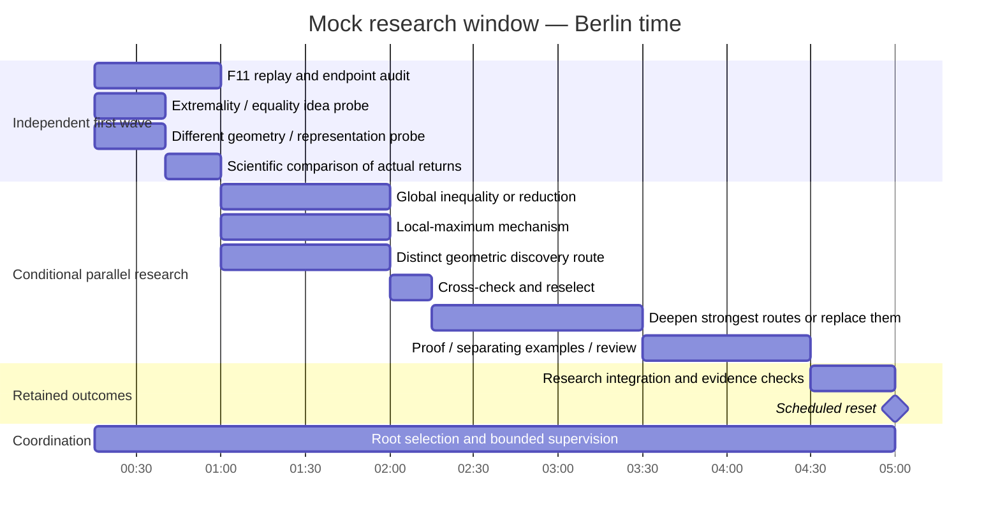

> Historical evidence retained on 12 October 2026. This dated proposal, dispatch or candidate is not active guidance, ownership, quota or execution authorization.

# Mock research night · 5 October 2026

Illustrative trajectory, not a selected schedule or a prediction. All times are
Berlin time. It assumes a 00:15 start; later work changes after actual returns.
Quota available at preparation: 99%. Phase consumption is unknown; model-minutes
and parallel worker counts are not quota percentages.

[Rendered PNG](research-night-mock.png) · [Graph source](research-night-mock.dot)

At each fan-in, a useful conjecture/reduction leads to derivation and adverse
checks; a counterexample/obstruction leads to its mathematical consequences;
a known identity or weak payoff leads to a different probe. A concrete deep
crux can justify bounded Astra reasoning with independent review.

Hypothetical story: F11 passes; ideation finds one worthwhile reduction and one
misleading feature; derive the reduction, explain the feature's counterexample,
and replace its discovery route. These are invented outcomes for the mock.

Root owns allocation and outcome accounting; scientific leaves own mathematical
reasoning and their child integration. Initial Sol 6.1 idea probes and F11
acceptance can run in parallel. Later 2–4 scientific owners and reviewers are
conditional on useful returns; Luna is available for cheap friction/source probes.
