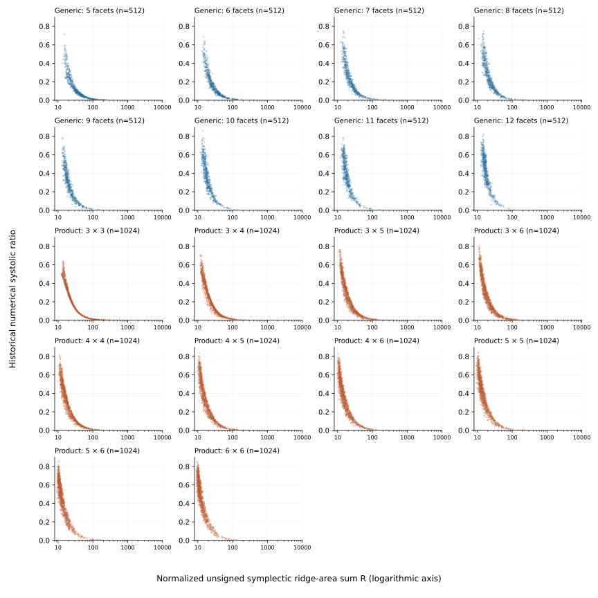

# An inverse ridge-area signal and its tested use in selection

Among sampled four-dimensional polytopes, bodies with less symplectic area on their two-dimensional faces, relative to volume, generally had larger **recorded numerical systolic ratios**. This suggests a search question: can face geometry identify promising bodies before their capacities are computed? The broad association gives a reason to try, but it does not say how to improve an individual body.

## The observed ordering

For a polytope $K$, call a two-dimensional face a *ridge* and set
\[
R(K)=\frac{\sum_F\left|\int_F\omega_0\right|}
{\sqrt{\operatorname{vol}_4(K)}}.
\]
\[
\operatorname{sys}(K)=\frac{c_{\mathrm{EHZ}}(K)^2}{2\operatorname{vol}_4(K)}.
\]
The absolute value is taken on each face before summation; $R$ measures symplectic area without cancellation between ridges. A ridge's symplectic area can vanish even when its Euclidean area is positive. Both mathematical quantities are invariant under translations, common dilations and linear symplectic maps. In this section $\widehat{\operatorname{sys}}$ denotes the recorded numerical ratio, whose floating-point volume is not certified.

The retained sample contains 4,096 generic polytopes and 10,240 Lagrangian polygon products. Smaller $R$ is associated with larger $\widehat{\operatorname{sys}}$ even within each sampled facet-count or polygon-size group. The pooled Spearman correlation is about $-0.94$: ordering bodies by $R$ tends to reverse their ordering by numerical ratio. The Pearson correlation is only about $-0.21$, so a straight-line relation between the values would misdescribe the finding. Among the lowest ten percent by $R$ within each group, the pooled correlation of within-group ranks weakens from $-0.944$ to $-0.222$. Selection can therefore reach a region where $R$ no longer orders candidates nearly as well as it orders the full sample.

View the observation by sample group

<figure><figcaption>Each point is one retained body. Generic polytopes and Lagrangian products are displayed separately, with panels by facet count or polygon sizes and a logarithmic horizontal scale. This describes the same historical sample as the text, not an independent replication or a uniform sample of convex bodies. Figure and input receipt: <a href="../../../../../../experiments/writing-quality/runs/20260918-human-feedback-revision/figures/README.md">September figure packet</a>.</figcaption></figure>

## What product geometry explains

For polygons $P$ and $Q$ placed in the standard $q$- and $p$-coordinate planes, let $a_i,b_j$ be their cyclic edge vectors and $A_P,A_Q$ their areas. The faces inside one factor plane contribute zero; a mixed rectangular ridge contributes $|a_i\cdot b_j|$. Thus
\[
R(P\times_LQ)=\frac{\sum_{i,j}|a_i\cdot b_j|}{\sqrt{A_PA_Q}}.
\]
For two relatively rotated regular pentagons of circumradius one, let $d$ be the angle's distance from $(\pi/5)\mathbb Z$, reduced to $[0,\pi/10]$. Their edge pairings give $R=16\sin(\pi/5)\cos d$. The proved capacity profile then gives the exact identity
\[
\operatorname{sys}(K_d)R(K_d)^2=16(3+\sqrt5).
\]
In this family, decreasing $R$ raises the systolic ratio; the endpoint $d=\pi/10$ is the Haim–Kislev–Ostrover (HKO) pentagon-product position with ratio greater than one. This is a later mathematical interpretation of one inverse relation, not the historical origin of the exploratory screen or an explanation of every sampled product.

The direction reverses elsewhere. For equilateral-triangle products, both $R$ and the exact systolic ratio decrease as the reduced relative angle increases. Two specified triangle–hexagon and square–square paths likewise have numerical decreases in both quantities at every retained step; those points do not prove monotonicity between them. The pentagon law therefore cannot make ridge minimization a universal direction of improvement. The more modest question is whether $R$ still helps allocate capacity evaluations across newly generated bodies.

## Selecting new candidates before evaluation

In a fresh pool of 100,000 polygon products, selecting the ten lowest-$R$ bodies per side-count group **before** evaluating capacity gave mean numerical ratio $0.626$, against $0.316$ for the same number of disjoint, same-pool controls chosen without capacity values. Only a selected/control union was evaluated, not all 100,000 candidates. This supports coarse enrichment in that pool; the conditional attenuation reported above concerns the original sample, not this fresh pool.

A separate fresh pool tested a refinement for low-$R$ candidates. Let $C$ be the largest ridge's share of total symplectic ridge area. In each side-count group the rule retained the lowest one percent by $R$ and compared its lower-$C$ half with the upper half. **Before capacity evaluation**, the descriptive success criterion was fixed as a positive overall mean difference and positive differences in at least seven of ten groups. The lower-$C$ half exceeded the other half by about $0.034$ overall, with positive differences in eight groups. This is additional association conditional on low $R$, not an isolated causal effect of concentration or a significance test.

The same two-stage ridge rule was then applied to one changed polygon source: support heights were set to one and each factor separately normalized to area one; both the original and changed polygons had to pass the admission conditions. In each of the $4\times6$ and $6\times6$ groups, the rule selected sixteen of 3,200 eligible products. Sixteen controls per group were selected by fixed hash order, without capacity values, from bodies outside both this ridge selection and a concurrent covariance selection.

| Factor sides | Selected mean $\widehat{\operatorname{sys}}$ | Control mean $\widehat{\operatorname{sys}}$ |
|:--|--:|--:|
| $4\times6$ | $0.637$ | $0.371$ |
| $6\times6$ | $0.708$ | $0.523$ |

The rule enriched mean numerical ratio in these two finite groups under this one conditioned source. No evaluated body in these generated-selection and transfer panels had ratio above one. One source seed and two transfer groups establish neither recurrence under other laws nor a probability of finding a counterexample. The scientific result is a useful selection signal with a clear mathematical example and explicit limits, not a general ascent principle.

*Source and design note.* The historical sample uses independent uniform unit normals and support heights in $[0.8,1.2)$, conditional on boundedness and retention of every proposed facet; it is not a uniform sample of convex bodies. [The replay account](../../../../../../topics/empirical-studies/evidence-closure/README.md) owns its reported association. [Current revalidation](../../../../../../topics/empirical-studies/retrospective-revalidation/README.md) supplies capacity intervals for 14,335 of the 14,336 original bodies but does not certify their numerical volumes or retrospectively turn their recorded ratios into exact values. The product identities and contrary paths are supported by [ridge mathematics](../../../../../../topics/empirical-studies/evidence-closure/ridge-mathematics.md), [the selected Chapter 8](../../../../../../thesis/chapters/08-data-science.tex), and [the endpoint-path packet](../../../../../../topics/empirical-studies/sys-datascience/methods/ridge-endpoint-path/INTERPRETATION.md). The [initial selection packet](../../../../../../topics/empirical-studies/sys-datascience/methods/extreme-scalar-rejection-proposer/artifacts/100k-promising-scalars/README.md), [concentration validation](../../../../../../topics/empirical-studies/sys-datascience/methods/extreme-scalar-rejection-proposer/artifacts/100k-ridge-concentration-validation/README.md), [transfer design](../../../../../../topics/empirical-studies/sys-datascience/methods/alternative-source-transfer/README.md), and [frozen analysis](../../../../../../topics/empirical-studies/sys-datascience/methods/alternative-source-transfer/artifacts/transfer-v1/analysis.json) own the prospective comparisons.
