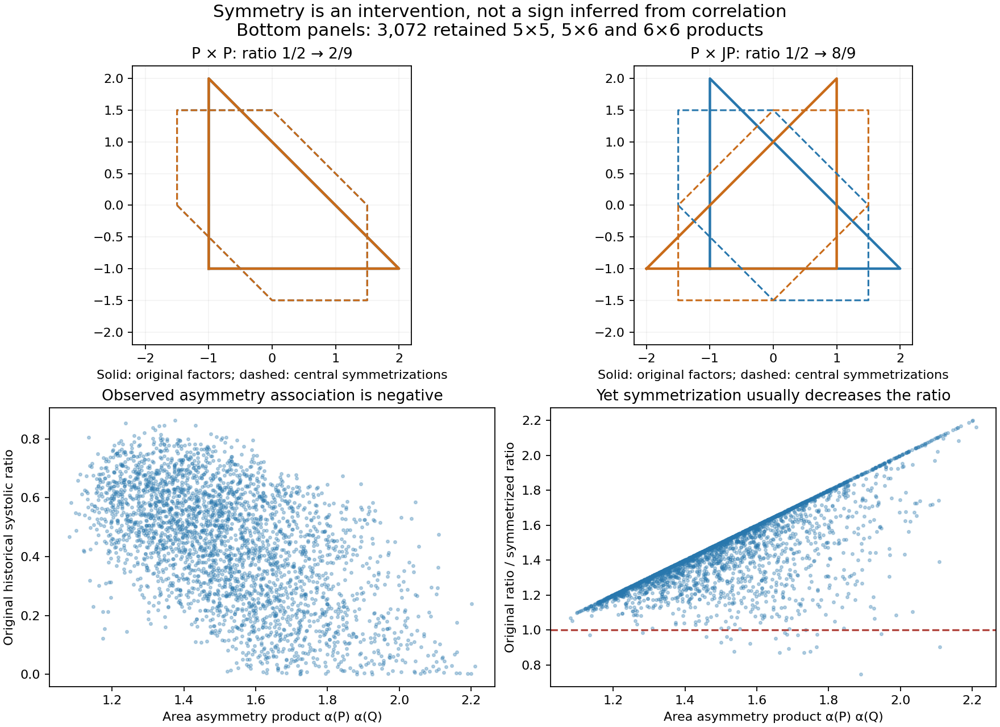
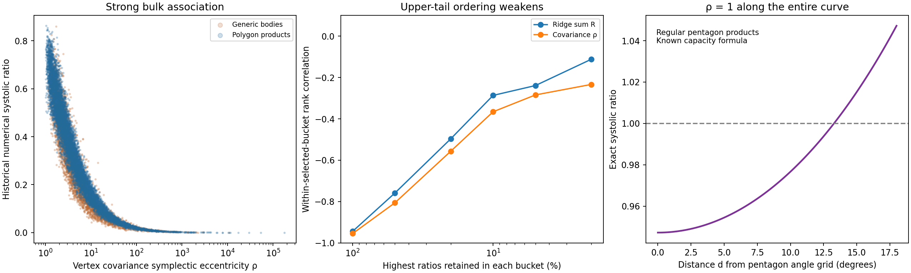
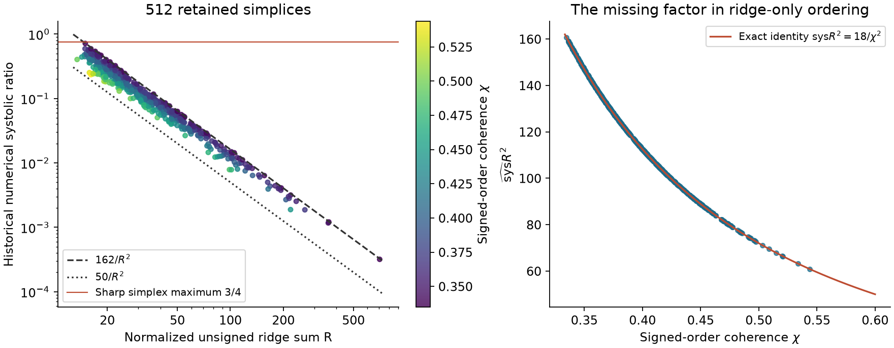
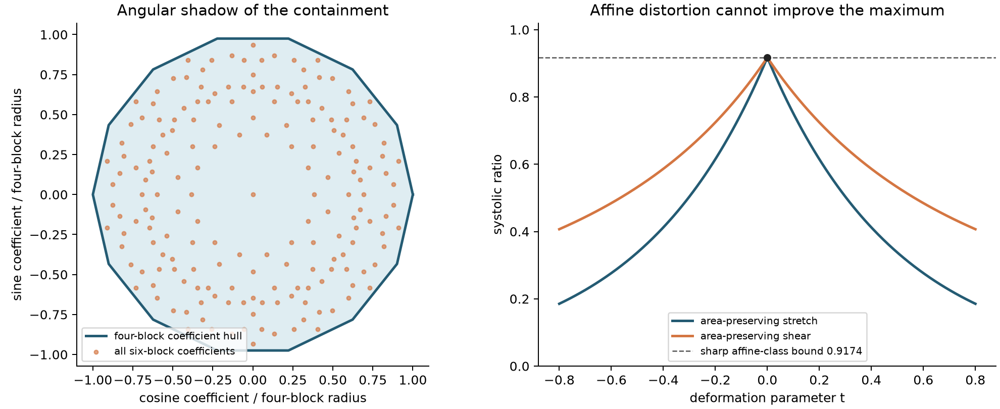
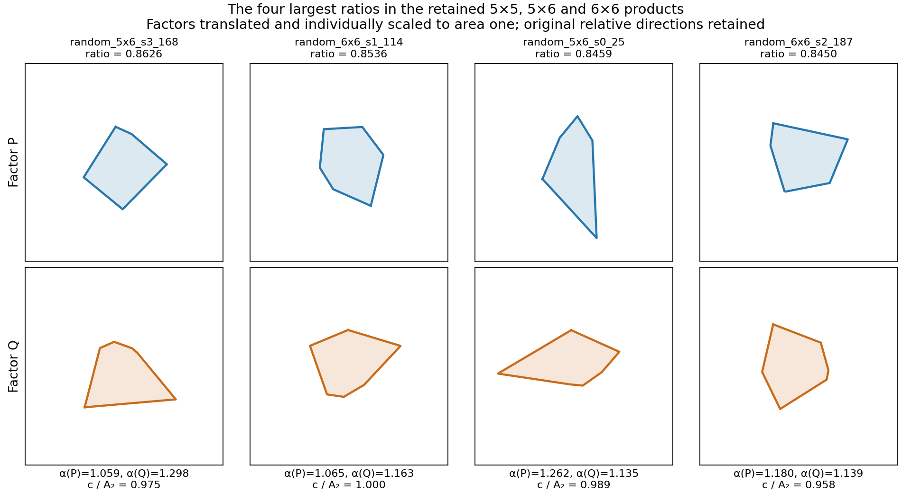
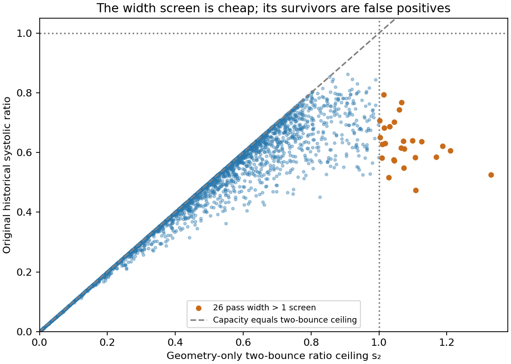
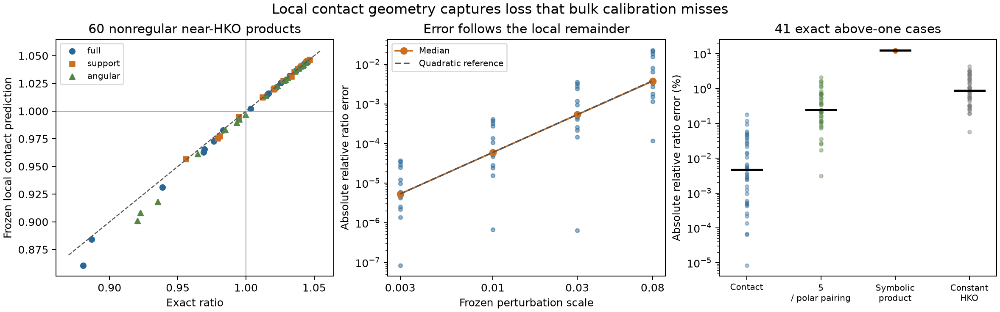

# Pattern gallery — 17 October 2026

**Upper-tail follow-up:** an explicit contact defect now predicts nonregular products near HKO, with a proved local loss law and a canonical product-invariant form. It fails the broader retained random 5×5 upper tail. [UPPER-TAIL.md](UPPER-TAIL.md) contains the positive result, exact obstructions, blind tests and global-proof limits. No broad predictor, new record body or global maximality proof is claimed.

The starting targets are in [SUCCESS.md](SUCCESS.md). [Proposed chapter paragraphs](PROPOSED-CHAPTER-TEXT.md) prioritize explanations over additional model scores. [Reproduction and verification](README.md) distinguish proofs from historical numerical labels. All ratios use $c_{\rm EHZ}^2/(2\operatorname{vol}_4)$. The retained source contains 4,096 generic bodies and 10,240 products; the separately known HKO reference is not a random observation.

| Pattern | What changes understanding | Evidence |
|---|---|---|
| 7. Local contact loss predicts the HKO tail | One nonsmooth contact contrast explains the leading loss; the canonical score transfers to a second fresh local panel but fails the broader random bucket. | Exact finite-envelope theorem, fresh nonregular panels and a full retained 5×5 transfer test |
| 1. Symmetrization has opposite signs | Identical original ratios and factor asymmetry can produce improvements or losses depending on relative position. | Exact rational controls; complete retained paired comparison |
| 2. Degree-four moments miss the threshold | Identical low moments coexist with ratios on both sides of one; the missing angle first appears at harmonic five. | Short algebraic proof using the known pentagon profile |
| 3. Simplex signed ridge law | Unsigned ridge sum omits a factor with sharp range; the whole five-facet bucket has a sharp 3/4 ceiling. | Finite exact polytope lemma + proof + 512-row correspondence |
| 4. Affine heptagon family closed | Independent shears and stretches cannot beat the regular midpoint position; sharp maximum ≈0.917408. | New 48-case exact interval certificate + independent proof/code review |
| 5. A 97% predictor misses the tail | High held-out bulk fit does not resolve the geometry of near-maximizers. | Bucket holdouts, transfer tests and exact adversarial family |
| 6. Width ceiling is insufficient | All 26 eligible sampled above-one width candidates have actual recorded ratios below 0.80. | Complete geometry scan and independent inradius checks |

## 1. More symmetry can lower or raise the ratio

**Statement.** Put $P=\operatorname{conv}\{(-1,-1),(2,-1),(-1,2)\}$, $J(x,y)=(-y,x)$, and $S=(P-P)/2$. Both $P\times_LP$ and $P\times_LJP$ have ratio $1/2$. Symmetrizing both factors gives $2/9$ and $8/9$, respectively. The original ratios, capacities and individual factor asymmetries agree, but the operation's sign reverses.

**Evidence strength.** Exact rational complete triangular closure enumeration plus the existing theorem for two centrally symmetric factors. Across the 10,240 retained products, asymmetry and historical ratio correlate negatively (Spearman ≈−0.517), yet paired symmetrization lowers the ratio in **10,117** cases (98.80%); median original/symmetrized quotient **1.609**. The paired counts use historical numerical labels, not certified ratio intervals.

**Falsification.** A quarter-turn of one factor defeats both proposed rules “more symmetry improves sys” and “the amount of asymmetry decides whether symmetrization helps.” Independent polar-inclusion and direct boundary minimization agree on 58 selected geometry checks. **Proof prospect:** the obstruction is already proved under the explicitly named existing product theorems. A general sign criterion needs relative position/closure information. [Full statement, factor-area decomposition and verifier](product-shape/REPORT.md).

## 2. All moments through degree four are blind to an above-one transition

**Statement.** For uniform measure on the 25 extreme vertices of $P_5\times_LR_\theta P_5$, **every coordinate moment of total degree ≤4 is independent of θ**, while the known exact ratio ranges from $(5+2\sqrt5)/10$ to $(3+\sqrt5)/5$. Their difference is **exactly 1/10**, crossing one. Consequently no function of that complete moment tensor can decide the threshold on this family.

**Evidence strength.** A complete root-of-unity proof: $\mathbb E[z^a\bar z^b]=0$ unless $5\mid a-b$; degree ≤4 only permits the angle-independent case $a=b$. Product measure factorizes. The capacity profile is previously established repository mathematics; the low-moment obstruction is this run's deduction. No literature novelty assertion.

**Falsification.** All 70 monomials at 101 angles agree within $2.22\times10^{-16}$, checking the implementation independently of capacity production. The fifth moment $M_5(P_\alpha)=e^{5i\alpha}$ recovers the reduced angle through $|\cos5\theta|$, and reconstructs the exact profile. **Proof prospect:** complete short proof. The fifth-harmonic descriptor is factor/coordinate aware; it is not a universal symplectic invariant or an empirically validated generic predictor. [Proof and scope](features/REPORT.md).

## 3. Signed ridge circulation explains every simplex

**Statement.** A four-simplex has
$$
 \operatorname{sys}=\frac{18}{\chi^2R^2},\qquad
 \frac13\leq\chi\leq\frac35,\qquad
 \boxed{50\leq\operatorname{sys}R^2\leq162},\qquad
 \boxed{\operatorname{sys}\leq3/4}.
$$
Both ridge-envelope endpoints and the ratio maximum are attained. Here $R$ is the usual unsigned normalized ridge sum; $\chi$ is the maximal signed forward sum over facet orders divided by the total unsigned sum. Thus $R$ omits a coherent signing/order factor, even with combinatorics fixed. Two exact rational simplices have the same $V=1/192$ and $R^2=363$, but ratios **6/25** and **3/8**, directly ruling out any universal function of $R$ alone.

**Evidence strength.** Barycentric gradients reduce capacity to 24 cyclic orders on a six-dimensional space of skew circulations. An exact rational enumeration of all **134,596** active bases proves its unit ball is the convex hull of 20 triangle circulations. An elementary triangle-free graph argument and directed-cycle decomposition give the sharp bounds. The ordinary coordinate simplex attains ratio 3/4; a nondegenerate five-cycle circulation attains the lower ridge-envelope endpoint. No classification of every equality simplex or literature novelty claim is made.

**Falsification.** All **512** retained five-facet bodies independently match the capacity formula to relative $8.33\times10^{-15}$ and the ridge formula to $4.00\times10^{-15}$. Their largest recorded ratio is 0.714410, whose separation from one is explained by the theorem. Numerical optimization and floating hull discovery were replaced by the exact lemma rather than presented as proofs. **Proof prospect:** complete finite proof relative to the repository's HK formula, independently checked. Computing $\chi$ solves the full simplex ordering problem, so it is an explanation rather than a target-free cheap predictor. [Full derivation and certificate](simplex/REPORT.md).

## 4. Independent affine heptagons cannot beat their regular midpoint position

**Statement.** For the circumradius-one regular heptagon with outward normals $n_i$, set $w=1+\cos(\pi/7)$, $S_7=(7/2)\sin(2\pi/7)$, $M=G^{-1}H^{-T}$, and $m(M)=\max_{i,j}|n_i^TMn_j|$. For every invertible pair $G,H$,
$$
 c(GP_7\times_LHP_7)=\frac{w^2}{m(M)},\qquad
 \operatorname{sys}\leq\frac{w^4}{2S_7^2}\sec^2(\pi/14)
 =0.9174081964\ldots<1.
$$
Equality holds exactly when $M=tR_{\pi/14}U$, $t>0$, and $U$ is a dihedral symmetry of the regular fourteen-gon generated by $\{\pm n_i\}$.

**Evidence strength.** **New computational proof in this run**, extending the retained rotation-only heptagon result to arbitrary independent affine deformations. All six-block competitors lie strictly inside the four-block tensor hull. An integer-only interval verifier checks **48** exhaustive representative systems with coefficient mass below $24/25$. A separate mathematical/code reviewer checked the full implication, representative coverage, interval arithmetic, normalization and equality argument. Human acceptance and external novelty remain unassessed.

**Falsification.** A breadth screen covered all 55 unordered pairs with side counts 3–12. A universal width formula fails already on triangle products. Stronger four-dimensional tensor containment was tested before selecting heptagons; a sparse exact certificate replaced the numerical hull check. **Proof prospect:** complete finite certificate conditional on the established sparse-product/four-block reductions. It covers affinely regular heptagons, not arbitrary heptagons or fourteen-facet bodies. The general odd-polygon theorem remains unresolved. [Proof, verifier and breadth ledger](regular/REPORT.md).

## 5. Two invariants explain 97% of bulk log variance, but not the selected tail

**Statement.** Quadratic regression on log ridge sum $R$ and log vertex-covariance eccentricity $\rho=\nu_2/\nu_1$, holding out each exact generator bucket, gives pooled log-ratio $R^2=0.97305$. On the **pooled 1,446 rows selected from the top decile within each bucket**, it gives **−0.07079**. Covariance alone gives 0.96235 and 0.02126, respectively.

**Figure.** First two panels of the moment figure in entry 2. **Evidence strength:** descriptive, post-target model falsification on 14,334 common rows (two preexisting covariance exclusions explicitly retained). The selected-tail score uses its pooled mean without bucket centering; it does not assert a negative score in every family. Bulk covariance association was already known. These new matched holdout/tail tests locate its limitation.

**Falsification.** Bucket holdouts, representation-hash holdout, generic↔product transfer and conditional reranking all test different extrapolations. The combined model's good bulk score survives the first two, but adding ridge sum worsens the pooled top-decile prediction relative to covariance alone. **Proof prospect:** no regression theorem claimed; entry 2 proves a stronger, model-independent limitation of low moments. This score comparison is supporting evidence for that obstruction, not a result selected for marginal numerical improvement. [Models, full coefficients and per-bucket metrics](features/REPORT.md).

## 6. Above-one two-bounce ceilings are false positives in the sampled upper tail

The four largest retained ratios in these buckets are shown with both factors normalized to area one. Their labels distinguish the width ceiling from the full recorded capacity; these are sample leaders, not a classification of near-maximal mathematical products. Raw factor vertices are retained in [top-shapes.json](product-shape/top-shapes.json).

**Statement.** In all 3,072 retained 5×5, 5×6 and 6×6 products, the geometric ceiling $s_2=c_2^2/(2A_PA_Q)>1$ selects **26** bodies (11, 11, 4). Their recorded actual ratios are only **0.4745–0.7947**. The largest ceiling is **1.32957** but its body's recorded ratio is **0.52615**.

**Evidence strength.** Complete independently reconstructed difference-body geometry, checked source hashes and cross-method inradius checks; historical numerical capacity/volume targets. The bound $c\leq c_2$ is valid; sufficiency is what fails. **Falsification:** inspect every above-one survivor, not just selected failures. Competing three-bounce paths can dominate precisely where the width ceiling looks most promising. **Proof prospect:** the existing two-bounce theorem explains the bound, while a full classification of takeover is not supplied. Useful as a cheap rejection bound; not an objective that alone identifies near-maximizers. [Complete survivor list and geometry checks](product-shape/REPORT.md).

## 7. A nonsmooth contact invariant predicts local above-one losses

**Statement.** In a canonical local slice through the HKO product orbit,
$$\log\operatorname{sys}(K)=\log\rho_H-I(K)+O(d^2),\qquad \rho_H=(3+\sqrt5)/5.$$
The score comes from one linear shape contrast plus an absolute orthogonality defect, repeated over ten contact modes. Its canonicalization is invariant under the specified planar-product coordinate group; this is not an invariant for arbitrary nonproduct bodies.

**Evidence strength.** The first frozen 60-product panel has 41 exact above-one ratios; the raw local formula's median/worst relative ratio errors there are **0.00467% / 0.18043%**. On a second panel's **23 above-one cases**, the canonical exponential has **0.00656% / 0.12860%** errors. The second panel contains 45 fresh distinct untransformed products and nine coordinate copies; directions and scales are grouped, not independent statistical trials. All threshold classifications in both finite panels are correct. Exact word enumeration, derivative rank and a finite gauge census support the local theorem.

**Falsification and proof status.** Both fixed canonical formulas fail upper-tail ranking on all 1,024 retained random 5×5 products (top-decile Spearman **−0.008**). An exact retained-body counterexample also blocks using them as universal ratio ceilings. Global maximality would require a separate inequality controlling supports away from HKO. Signed ridge spectra, complete rotational mixed-area profiles, a normalized polar pairing and smooth action-moment scores have new exact upper-tail obstructions. The symbolic search can rank fresh cases extremely well while putting every above-one case below one. These failures motivate the nonsmooth local contact law, but establish no global predictor. [Complete result and reproduction](UPPER-TAIL.md).

## Refuted, stopped and still open

| Candidate | Disposition |
|---|---|
| Central symmetrization universally improves the ratio | Refuted by exact entry 1; its reverse is refuted by the rotated control. |
| Scalar asymmetry decides the sign of that intervention | Refuted by identical-asymmetry controls with opposite signs. |
| Low moments determine the threshold | Refuted through degree four by entry 2. |
| Ridge sum alone determines simplex capacity/ratio | Refuted by exact equal-R, equal-volume controls with different ratios; entry 3 identifies the missing signed-order factor. |
| A high bulk predictive score establishes useful tail ordering | Refuted for these fitted models; does not rule out other models. |
| A large two-bounce ceiling suffices for above-one search | All 26 eligible retained survivors fail; no universal success theorem. |
| Product facet-word length reveals the two-/three-bounce mechanism | Stopped: all 10,240 stored product words have length six, including 3,979 two-bounce labels. Facet length differs from alternating block count. |
| One stored word establishes optimizer uniqueness/tie structure | Unsupported: every historical body stores one returned word, not a complete minimizer family. |
| Universal width formula for all regular polygon products | Refuted by small triangle products; this exception was already known in the retained research. |
| General tensor containment for all odd side counts ≥5 | Supported by the bounded numerical screen; only the heptagon extension was proved here. |
| Arbitrary pentagon products have a complete near-maximizer classification | Not established; the affine pentagon theorem covers a narrower family. No new claim fills that gap. |

Independent reviews are retained in [reviews/](reviews/). No thesis chapter was edited. Questions were recorded early in the queue and shared `pm` group; unanswered priors did not select or block an experiment.

[review: /root/message_reviewer]
[review: /root/run_reviewer]
