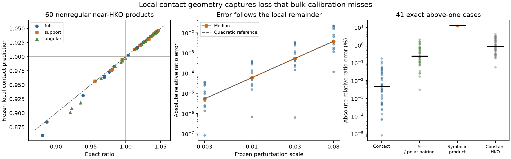

# Upper-tail contact invariant: local prediction and transfer limits

**A nonsmooth contact defect predicts the systolic loss of nonregular products near HKO, with a proved first-order law. Its canonical form is a genuine invariant of planar pentagon products. It fails on the broader retained random-product upper tail.** The requested broad predictor and a new route proving global maximality remain open; the useful positive result is an explicit local law, accompanied by exact obstructions that explain why several smoother summaries fail.

**21 UTC continuation:** a new [geometry-coverage theorem](upper-tail/chord-star/REPORT.md) certifies approximation intervals for continuous closure-chord candidates; it tightens six existing near-HKO relaxation intervals, but remains weak on hard random controls. New [reflected-cover](upper-tail/reflected-contact/MINKOWSKI-REPORT.md) and [principal-spectral](upper-tail/spectral-chord/REPORT.md) analyses prove different failures under tie-breaking. The spectral construction nevertheless supplies a new exact feasible capacity bound more than 10% below both earlier geometric bounds on one retained body. These results are detailed below. They do not establish the requested broad held-out predictor or global maximality.

All new above-one panels are controlled perturbations of the known HKO construction. The target statements were written [before new computation](upper-tail/RUN-TARGETS.md). All ratios here are $c_{\rm EHZ}^2/(2\operatorname{vol}_4)$. No thesis source was edited. This report distinguishes a constructed above-one neighborhood from an upper decile of the old random distribution; they are materially different tests.

## Best surviving invariant

Let $z_0$ be the retained HKO normal presentation and $\rho_H=(3+\sqrt5)/5$. The fifty HK word branches active there have only twenty distinct logarithmic loss gradients

$$g_w=\left.\mathrm d\log(8Q_w^2 V)\right|_{z_0},\qquad
 D(\delta)=\max_w g_w\cdot\delta.$$

These are fixed algebraic coefficients, computed once at the known reference; applying the score to a new body uses only its geometry. No new capacity label is fitted or searched. The construction does import known capacity information at HKO, so it is an analytic local surrogate rather than a capacity-independent discovery of a universal law.

The twenty forms compress to **one linear shape contrast plus an absolute orthogonality defect**, repeated over five cyclic positions and two factor roles:

$$D(\delta)=\max_{j,\,\text{role}}
 \{L_{j,\text{role}}(\delta)+\tfrac{3-\sqrt5}{2}
 |\mathrm d(a_j\cdot b_j)|\}.$$

The explicit $L$ and all coefficients are in the [contact proof](upper-tail/contact-stability/REPORT.md). The absolute value records the split between tied contact orderings. This is why a smooth average can miss the leading loss even when it records shape anisotropy accurately.

The raw $D$ is a chart score. To obtain a product invariant $I$, affinely map three alternating vertices of the first factor to the reference triangle, transform the second factor contragrediently, center it at its area centroid, and fix its remaining positive scale by a reference support coordinate. Minimize $D$ over the finite choices of cyclic labels, common orientation and factor role (at most 100). This fixes nine gauge parameters and leaves eleven shape coordinates. The [canonical proof and fresh test](upper-tail/contact-stability/CANONICAL.md) establish invariance under translations, product-preserving linear symplectic maps, positive conformal scaling, facet relabelling and factor interchange. This is not an invariant of arbitrary four-dimensional bodies after transformations that remove the product splitting.

**Local theorem.** In a sufficiently small neighborhood of the HKO product orbit, using the canonical slice,

$$\boxed{\log\operatorname{sys}(K)=\log\rho_H-I(K)+O(d(K,\mathcal O_H)^2).}$$

Here $d$ denotes local transverse coordinate size, not a newly certified global distance. The primary prediction is $\widehat\rho=\rho_H e^{-I}$. A separately frozen alternative is $\rho_H/(1+I)$. Neither is asserted to bound capacity or ratio globally. The scalar formula is compact, but finite gauge normalization is more elaborate than a width/ridge summary and has not been shown faster than sparse exact product capacity computation; its value is the explicit loss mechanism.

The proof uses the existing six-facet HK reduction, a full exact census of $25\times120=3,000$ reference word branches, and a strict gap to every inactive branch. Finite analytic Taylor expansion gives a uniform quadratic remainder. The twenty gradients have rank eleven, sum to zero, and annihilate precisely the nine symmetry tangents; their maximum is a positive asymmetric polyhedral gauge on the quotient. An exact census of canonical reference representatives supplies the extra condition needed when taking the minimum over gauges. This is a proved local expansion relative to the imported capacity formula, not just a fit. It supplies an existential neighborhood and remainder constant, not a numerical certified radius.

HKO local maximality was already proved in a broader repository class. The new result is the explicit directional loss mechanism, its coordinate-invariant realization and blind predictive tests; no new local-maximality priority is claimed.

## Held-out upper-tail performance and the failed transfer

The first panel was frozen before its exact oracle: five separately generated directions, three perturbation mechanisms and four scales, with all 60 products included irrespective of outcome. It contains 41 exact above-one ratios, ranging from $1.003351\ldots$ to $1.046614\ldots$. The raw chart formula was the primary frozen predictor. A second independently generated panel tested the canonical invariant: 45 new products plus nine transformed copies used as coordinate controls. Only the 45 distinct untransformed geometries count as fresh ratio tests. Both panels reuse each seed direction across mechanisms and scales, so rows are correlated; they are not 60 or 45 independent statistical trials.

| Fixed predictor and test | Cases | Median relative ratio error | Worst error | Ratio $R^2$ |
|---|---:|---:|---:|---:|
| Raw contact formula, first entire panel | 60 | 0.02343% | 2.24934% | 0.98534 |
| Raw contact formula, first above-one subset | 41 | 0.00467% | 0.18043% | 0.99844 |
| Canonical exponential, second distinct panel | 45 | 0.06190% | 1.8487% | 0.99446 |
| Canonical exponential, second above-one subset | 23 | 0.00656% | 0.12860% | 0.99879 |

Every above/below-one classification is correct on each of these two finite panels. The first panel's median raw error grows approximately quadratically with perturbation scale: 0.00053%, 0.00592%, 0.05302%, 0.37270%. A constant HKO prediction has $R^2=-1.48386$ on its above-one subset. Thus the result captures actual variation; it is not explained by simply predicting the nearby reference value. These are constructed local validations, with tail subgroups selected for evaluation after scoring, not population accuracy estimates. The panels contain arbitrary normal/support perturbations, rather than just rotations of regular polygons.

The consequential adverse test is [all 1,024 retained random 5×5 products](upper-tail/canonical-transfer/REPORT.md). Their historical ratios span about 0.00149–0.84380, substantially outside the local regime. The formulas and canonicalization were frozen before that geometry-only pass and scored separately without fitting.

| Retained 5×5 upper decile | Median / p90 ratio error | Within-tail Spearman | Decile recall |
|---|---:|---:|---:|
| Canonical exponential | 25.76% / 40.57% | −0.008 | 0.282 |
| Canonical reciprocal | 12.09% / 24.46% | −0.008 | 0.282 |
| Existing two-bounce width ceiling | 8.66% / 35.18% | 0.512 | 0.563 |

At the top 2%, the canonical score's rank correlation is −0.586. Numerical product-coordinate invariance passed the fixed controls, so repairing invariance did not repair broad prediction. No further tuning followed. The exact counterexample retained with the canonical packet also rules out promoting either frozen formula to a universal upper bound. For `random_5x5_s0_92`, the exact ratio is 0.8385328154 while the canonical reciprocal predicts only 0.5590556413. The exponential is smaller still. The [exact obstruction](upper-tail/contact-stability/OBSTRUCTION.md) checks the finite gauge minimum and complete sparse capacity; the sign gap is about 0.27948, not numerical polishing.

## Broad search and what it ruled out

Six independent lanes compared signed ridge geometry, polar/Mahler geometry, support/mixed-area functionals, contact stability, action moments and symbolic formulas. The following are distinct conclusions, not additional successful predictors.

| Candidate | Consequential result | Evidence owner |
|---|---|---|
| Complete signed ridge spectrum | A rational, nearly regular but non-affine-regular isospectral continuum stays above one. Two ratios are 1.00822777 and 1.04490354, forcing at least 1.7863% relative error for one of them from any common spectrum-only prediction. | [Exact construction and interval certificate](upper-tail/spectral-geometry/REPORT.md) |
| Complete rotational mixed-area profiles | Nonregular products share every rotated self/partner mixed area and areas, but have ratios 1.00704749 and 0.99736753. Another matched pair has both ratios above one. The omitted support phase gives a sharp stability envelope. | [Proof and algebraic controls](upper-tail/mixed-area-global/REPORT.md) |
| Normalized maximum polar symplectic pairing $X=\alpha\sqrt V$ | Exact equal-$X$ examples have ratios 0.99094226 and 1.01224774. Thus no function of this scalar alone decides above one. This does not rule out combining it with independent geometry. | [Centroid-normalized polar obstruction](upper-tail/polar-geometry/REPORT.md) |
| Smooth invariant scores and finite action moments | A differentiable cyclic-invariant HKO-calibrated score is first-order flat along an explicit nonregular support deformation; true ratio has a linear cusp. Every fixed finite closure-action moment is flat there. A nonsmooth outer function remains possible. | [Theorem, moment factorization and blind failure](upper-tail/action-spectrum/REPORT.md) |
| Small symbolic formulas | Nested search over 130 all-body and 321 product expressions finds a product formula with historical tail median/p90 error 7.76%/16.20%. It ranks the fresh 60-body panel at Spearman 0.9879, yet predicts **all 41 above-one cases below one**. | [Grammar, frozen predictions and calibration obstruction](upper-tail/symbolic-search/REPORT.md) |

The polar formula $c\approx5/\alpha$ is exact on the already proved affine-regular-pentagon family and has only 0.54% median ratio error on the first nonregular panel. Its exact same-$X$ collisions and poor broad upper-tail fits prevent elevating it to the preferred invariant. The symbolic rule's strong rank but incorrect level is another reason to report calibration separately from rank and bulk $R^2$. Contact and polar predictions preceded the common oracle; action and symbolic predictions preceded those lanes' access to individual truths, after aggregate progress information was already visible. Their reports preserve that chronology.

The differentiability obstruction motivates a nonsmooth contact functional. It does **not** prove that every smooth feature set loses the information: a nonsmooth calibration, such as a square root of a quadratic defect, may recover a cusp. The mixed-area collision is stronger for its explicitly stated complete profile class because the inputs themselves agree exactly.

## Method selection, proof prospect and scope

Before new computation, the target was either a simple upper-tail law with a plausible global implication, or a material obstruction that excludes a real class of candidates. Raw bulk $R^2$ rewards degeneration and generator identity; tail rank rewards uncalibrated formulas; tiny best-ratio improvements reward numerical polishing; elegant special cases can evade the upper-tail question. We used upper-tail error and calibration, exact adversarial separation, invariance, simplicity and the actual proof implication together.

| Route | Tail evidence | Simplicity | Global-bound prospect after testing | Disposition |
|---|---|---|---|---|
| Passive polar/spectral/quadratic summaries | Broad fits or exact upper-tail collisions fail | Good | No surviving sharp implication | Stop tested forms |
| Symbolic combinations of those summaries | Historical tail improves; fresh above-one level fails | Good | Proposed Mahler envelope has an exact square×diamond counterexample | Stop frozen grammar |
| Full closure-pair capacity search | Exact truth | Solves the target itself | Existing algorithm, not explanatory compression | Oracle only |
| Contact loss on a canonical slice | Strong fresh local prediction; broader bucket fails | One contrast, finite gauge choices | Proved local expansion; no global inequality | Retain local result |

The tempting global statement

$$\operatorname{sys}(K)\le\frac{\rho_H}{1+I(K)}\le\rho_H$$

fails; it is not a new conjecture supported by this run. A genuine global argument would have to control inactive-support takeover, arbitrary normal fans and nonproduct geometries, or prove an independent sharp geometric covering inequality. The local rank/positivity certificate supplies none of those steps. The [triangle-cover reformulation](https://arxiv.org/html/2603.12495v1) is relevant external context, rather than a solved missing implication. The mean-width and nonsmooth-Zoll routes inspected in the [action source audit](upper-tail/action-spectrum/REPORT.md) also did not supply a sharp HKO certificate.

The inspected scope comprises this checkout's task/research/product/empirical/variation guides, prior stopped pattern packets, the retained code and input identities needed by each lane, and focused primary-paper checks. It is not an exhaustive repository or literature survey. External novelty and human proof acceptance are unassessed. Historical random-corpus targets retain their numerical status; the newly constructed rational panels and explicit certificates use exact areas and the complete imported sparse-product reductions. No unrestricted theorem is inferred from finite data.

## Continuation: coverage certificates and the choices lost at ties

The restarted owner task compared distinct mechanisms across shapes rather than repeating successful local contact panels. The [single-witness obstruction](upper-tail/reflected-contact/POSITIVE-CLOSURE.md) shows that simultaneous fivefold symmetry forces any equivariant single closure-pair assignment to be uniform at HKO. Even its best word then inflates the ratio ceiling by exactly $5/4$. This excludes that canonical witness class, without excluding general scalar invariants or set-valued rules.

Keeping a full geometric contact face avoids this averaging obstruction but can still lose the right choices. The frozen [reflected-cover selector](upper-tail/reflected-contact/MINKOWSKI-REPORT.md) recovers HKO and the earlier exact global-formula counterexample. An exact nonregular path proves its ratio ceiling nevertheless tends to $(9+4\sqrt5)/10\approx1.79443$ as the true ratio tends to $\rho_H\approx1.04721$: the full five-vertex faces collapse to an unfavorable sole pair. No broader population scan followed the decisive controls.

A distinct [principal-spectral chord selector](upper-tail/spectral-chord/REPORT.md) uses signed cross-factor interactions. Its ideal exact-leading-space form also loses reference continuity when a double leading singular value splits. The finite rounded implementation has separate verified feasible witnesses and a fixed clustering tolerance; the mathematical discontinuity is not asserted of that tolerance rule at arbitrarily small scales. On `random_5x5_s1_229`, it recruits facets missed by the independently minimum-area triangles and lowers the exact previous geometric capacity ceiling from $4.93809\ldots$ to $4.43141\ldots$, a $10.2607\%$ cut.

The frozen 1,024-body numerical comparison is retrospective. The predeclared spectral-plus-width rule has worse upper-decile median ratio error than the old triangle-plus-width rule, $5.65\%$ versus $3.88\%$, while improving the 90th percentile from $14.99\%$ to $13.15\%$. Adding spectral to the old two-way minimum **after scoring**, as an explicitly exploratory three-way comparison, gives median/90th errors $2.72\%/9.07\%$. It improves 121 of 1,024 old bounds, including 22 capacity cuts above $5\%$. Independent exact checking certifies every retained feasible witness and area; historical capacity labels remain numerical. These gains do not establish fresh-sample accuracy or an HKO-sharp global ceiling.

The positive construction keeps all coordinate-normal chords of each closure polytope. Let $C_\star$ be its best feasible bound after one opposite-factor response, and let $\eta$ measure the fraction of the full closure body covered by its chord hull. The [coverage theorem](upper-tail/chord-star/REPORT.md) proves, for all full-dimensional polygon factors,

$$\eta C_\star\le c_{\rm EHZ}\le C_\star,$$

with an analogous squared ratio bracket. The construction is invariant under the stated product symmetries and continuous within each irredundant fixed-facet stratum. At HKO, its chord hull is the full factor closure pentagon and $\eta=1$. On six already known nonregular near-HKO controls, it raises the conditional-LP lower endpoints by $12.66$–$16.82\%$, reducing interval factors from about $1.16$–$1.17$ to $1.00166$–$1.02909$ after retaining the old upper endpoints. Existing exact capacity values are unchanged. Hard random controls have weak coverage; this is an optimization certificate with no speed advantage claimed, not the requested simple broad predictor. A separate [facet-birth analysis](upper-tail/chord-star/FACET-AMENDMENT.md) proves that $\eta$ can tend to zero even along cuts whose finite example leaves true capacity unchanged. On that same body, an intrinsic [pruning-and-containment sandwich](upper-tail/chord-star/PRUNING-AMENDMENT.md) restores the certified interval factor from $84.53$ to $1.01806$. Its control is a single previously exposed added-facet body and path; the remedy is not claimed as broad prediction.

A final [absolute-ceiling crux](upper-tail/ceiling-crux/REPORT.md) tests the unchanged full-tangent star ceiling together with width against HKO's volume-normalized ratio. All 14 retained random width-hard products admit an exact eligible star witness below HKO; 60 constructed perturbations also pass the standalone star test, although width already suffices there. An independent checker verifies each geometry, closure, star membership, angular order and literal four-dimensional witness. This is bounded survival of an unproved sufficient condition, without new capacities, a new global theorem or a proof mechanism. The relative coverage theorem alone does not supply the absolute volume threshold. The next bounded analytic crux concerns facet-refinement degenerations, rather than another cohort.

Each new packet contains its prior alternatives, frozen controls, exact certificates and separate scientific/exact-text approval. The owner independently replays the full uniform-word check, the reflected-cover control certificates, every broad spectral witness and the ten-control coverage certificates. The scientific results remain on the patterns branch; the existing local-contact explanation is now selected separately in the working thesis with portable witnesses. Global maximality and broad held-out prediction remain open.

## Original six-lane run: reproduction, review and retention

[The verification receipt](upper-tail/synthesis/verification.json) lists the fresh root checks and packet reviews. Every new mathematical packet has a separate scientific/exact-text review; imported results retain their original acceptance limits. The root replays selected exact checks, checks packet hashes and local links, renders this report and gallery, and visually inspects the combined figure. See individual reports for input hashes and complete commands. No Rust or selected LaTeX source changed, so no unrelated workspace/thesis build is claimed.

All new working files began under `/tmp/msc-math/upper-tail-20261017/`; selected small scripts, fixtures, predictions, proof receipts and figures are retained beside their owners. Six hypothesis lanes and separate reviewers ran locally. No original large producer rerun, cloud job, reset consumption, push, merge, public deployment or external message occurred. Account quota and billed expenditure were not queried and remain unknown. The approved allowance was up to ten hours, not a requirement to spend it after the bounded hypotheses were settled.

One new question is kept only in shared `pm`, replacing the stale figure-selection question to respect the five-open-question thesis limit; the other four questions are preserved. No duplicate queue questions are written. The queue's Done entry points here. Assumptions were the recommended priorities: nonregular above-one geometry, generic/retained transfer as a distinct test, regular families only as controls, no manuscript promotion, and no need for an absent author's response.

[review: /root/run_reviewer]
