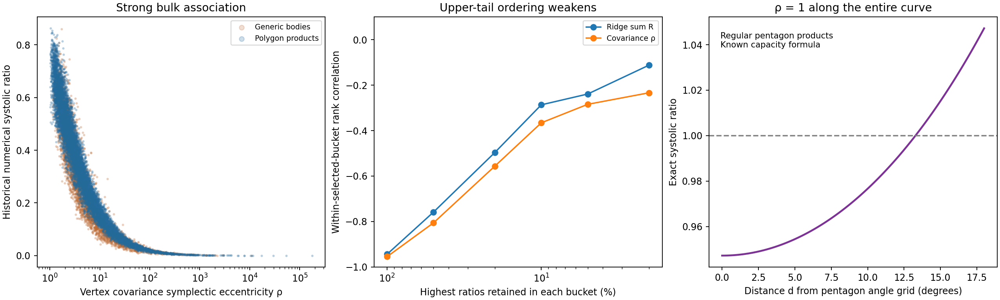

# Covariance predicts the bulk, but low moments cannot detect a known threshold

The strongest result here is an exact obstruction: all vertex moments through degree four are identical along the regular-pentagon rotation family, although its systolic ratio varies by exactly **1/10**, from below one to above one. The new retained-data calculations explain why a strong pooled prediction score should not be mistaken for a geometric explanation of near-maximal bodies.



## 1. Exact moment obstruction and first angular information

Let $P_\alpha$ be the circumradius-one regular pentagon with vertices
$e^{i(\alpha+2\pi j/5)}$, and let $K_\theta=P_0\times_LP_\theta$.
Use the **uniform probability measure on the 25 distinct extreme vertices** of this product. The following statement concerns this specified measure.

**Proposition.** Every real coordinate moment of total degree at most four of $K_\theta$ is independent of $\theta$. Nevertheless
$$
 \min_\theta\operatorname{sys}(K_\theta)
 =\frac{5+2\sqrt5}{10},\qquad
 \max_\theta\operatorname{sys}(K_\theta)
 =\frac{3+\sqrt5}{5},
$$
so the maximum minus minimum is exactly $1/10$. Consequently no function of the complete degree-four vertex-moment tensor can decide whether this family's ratio exceeds one.

**Proof.** For one factor, the average of a complex monomial is
$$
 \mathbb E[z^a\bar z^b]
 =e^{i(a-b)\alpha}\frac15\sum_{j=0}^4 e^{2\pi i(a-b)j/5}.
$$
The root sum vanishes unless $5\mid a-b$. When $a+b\le4$, its only nonzero case has $a=b$, and is independent of $\alpha$. Every real coordinate monomial is a linear combination of these complex monomials. Product vertex measure factorizes, proving the degree-four assertion in four dimensions. Finally the already established capacity formula gives
$$
 \operatorname{sys}(K_\theta)
 =s_0\sec^2d(\theta),\quad
 s_0=\frac{5+2\sqrt5}{10},\quad
 d(\theta)=\min_{k\in\mathbb Z}|\theta-k\pi/5|\in[0,\pi/10].
$$
Its endpoint values are exactly the two displayed constants. This proves the obstruction without a numerical capacity evaluation.

The capacity profile is **known repository mathematics**, sourced at [chapter 9](../../thesis/chapters/09-rotated-regular-polygons.tex), not a newly discovered capacity theorem. The moment obstruction is a new deduction/synthesis in this packet; no external novelty claim is made. It has agent-level mathematical status pending independent review and Jörn's acceptance.

The covariance special case is especially transparent. For fixed circumradii $r_A,r_B$,
$$
 C=\operatorname{diag}(r_A^2I_2/2,r_B^2I_2/2).
$$
The positive symplectic eigenvalues are both $r_Ar_B/2$. Hence their ratio $\rho=1$, their scale-free values $\nu_j/\sqrt{\operatorname{vol}_4K}$, and the volume are all constant along the rotation family. Even these full normalized spectral descriptors miss the threshold.

**What can first see the angle?** The fifth complex vertex moment is
$M_5(P_\alpha)=\mathbb E[z^5]=e^{5i\alpha}$.
For this regular family,
$$
 T=\frac{|\Re(M_5(P_\theta)\overline{M_5(P_0)})|}
 {|M_5(P_\theta)||M_5(P_0)|}=|\cos5\theta|,
 \qquad d=\tfrac15\arccos T.
$$
Thus the known profile can be expressed through the first available angular harmonic. This is a coordinate/factor-aware descriptor on this regular family; it is not asserted to be an invariant under arbitrary symplectic changes of coordinates or a successful feature on generic bodies. It identifies which information low moments discard.

**Cheap falsification/check.** The script enumerates all 70 monomials of total degree at most four on all 25 product vertices at 101 angles. Maximum drift is $2.22\times10^{-16}$. The fifth-harmonic identity agrees to $1.49\times10^{-15}$; reconstruction of the known ratio profile agrees to $2.22\times10^{-16}$. These are implementation checks of the direct algebraic argument, not its proof premises.

**Proof prospect:** complete short argument above. This is the best chapter-8 candidate in this packet because it gives an explicit reason why a seemingly excellent shape predictor misses the crucial threshold.

## 2. A two-invariant model exceeds 97% bulk log-variance yet misses the selected tail

Let $C$ be the centered, uniform covariance of the **canonical distinct primal extreme vertices**. Write $\nu_1\le\nu_2$ for its positive symplectic eigenvalues, meaning the eigenvalues of $JC$ are $\pm i\nu_j$, and set $\rho=\nu_2/\nu_1$. This eccentricity is invariant under linear symplectic changes, translation, and uniform scale. Let $R$ be the sum of unsigned symplectic ridge areas divided by $\sqrt{\operatorname{vol}_4K}$.

The covariance association was already known in [the covariance packet](../../topics/empirical-studies/sys-datascience/methods/canonical-vertex-covariance/README.md). The present new work compares simple transfer models with matched tail checks. It uses 14,334 common rows; the preexisting covariance contract excludes `random_F8_s3_45` and `random_F12_s2_38`. Their targets remain in the population, not silently claimed validated.

All models are ordinary least squares on **log(sys)**, using an intercept and either $(\log R,(\log R)^2)$, $(\log\rho,(\log\rho)^2)$, or their combined degree-two polynomial (six coefficients). Hold out each of the 18 exact facet-count/polygon-pair buckets in turn. No source/bucket metadata enters the predictors.

| Predictors | Pooled held-out log R² | Upper-decile log R² | Upper-decile sys MAE |
|---|---:|---:|---:|
| Ridge sum only | .95286 | −1.87610 | .10890 |
| Covariance eccentricity only | .96235 | .02126 | .07243 |
| Both, with quadratic interaction | .97305 | −.07079 | .07396 |

For the tail columns, select the largest $\lceil0.1n\rceil$ ratios **separately inside each bucket**, then pool the resulting 1,446 held-out rows. R² uses the **pooled selected log-target mean**, without bucket centering; it does not establish that every individual family has nonpositive tail R². Complete bucket metrics are retained in `by-bucket.csv`.

The corresponding deterministic representation-hash holdout, splitting within the represented buckets, yields bulk log R² .94929/.95932/.97074. Thus the bulk result is not produced only by a fortunate omitted bucket. However, training only generic bodies and testing products leaves a median prediction/target ratio .84849 for the covariance model; reverse transfer gives 1.15747. A pooled score conceals material calibration differences between source families.

The top-tail attenuation is also visible without fitting a model. Rerank both predictor and target inside each selected bucket, divide ranks by selected bucket size, then compute an outer Spearman correlation of the pooled percentiles:

| Highest ratios kept per bucket | R versus sys | ρ versus sys |
|---|---:|---:|
| 100% | −.94399 | −.95470 |
| 20% | −.49622 | −.55622 |
| 10% | −.28660 | −.36572 |
| 5% | −.23905 | −.28434 |
| 2% | −.11187 | −.23352 |

Neither the negative tail R² nor attenuation proves that a different model cannot work. Range restriction and generator effects remain possible contributors. The **exact moment obstruction** establishes the broader limitation for moment-only laws independently of regression choices. No prospectively frozen new-row proposer or causal explanation is claimed.

**Attempts to kill the bulk law:** leave exact buckets out; deterministic within-bucket holdout; transfer between generic bodies and products; top-decile error; conditional rank ordering; exact regular-pentagon controls. The bulk relation survives the first two, but its extrapolation to near-maximizers and a universal moment-based law does not.

**Method choice:** alternatives were (A) flexible many-feature fitting, (B) new capacity production, and (C) simple two-invariant transfer plus an exact adversarial family. Pooled R² rewards the large low-ratio spread and can conceal tail failure; tail R² alone can overpenalize predictors when the selected variance is small; best observed ratio rewards numerical polishing. The chosen rubric combines explanatory content, explicit falsifiers, and bounded cost. C resolves the meaningful question without another large production run. No claim depends on marginal model-score improvements.

## 3. Stored orbit words cannot establish an extremal motif

All 14,336 source bodies join the registered shared cache by their ordered rational dual coordinates. Every joined body stores exactly **one returned sigma**. All 10,240 products store a six-facet word, including all 3,979 bodies with producer metadata `bounces=2`. A facet word's length is not the number of alternating billiard blocks: same-factor neighboring facets can occupy one block. No padding or zero-weight inference is justified.

Generic word lengths vary from five to eleven. Their upper deciles retain multiple lengths in every bucket except the forced simplex case. No single common length characterizes generic upper-tail rows. This cheap candidate is therefore stopped. One stored returned word cannot establish uniqueness, the size of the complete minimizing family, or an absence of ties. Retained word action/length is observational output, not an independent pre-target predictor or a completeness certificate.

## Source and reproduction contract

`analyze.py` reads the retained 45-feature gzip, preexisting covariance JSONL, and verified offline registered sources/shared cache. It verifies pinned table/covariance/source hashes, exact unique table joins, historical target equality and complete orbit-source matching. Target identity remains the **historical numerical systolic ratio**. The separately retained [retrospective comparison](../../topics/empirical-studies/retrospective-revalidation/README.md) corroborates current capacity values for 14,335 bodies with scalar/interval distinctions and one unresolved body; numerical volume is not certified. These source qualifications are not replaced by this analysis.

No capacity or volume evaluator, full feature producer, cloud task, installation or source mutation was run. Inputs and experiments were inspected only along this feature/moment question; this is not an exhaustive literature or repository search.

```sh
OPENBLAS_NUM_THREADS=1 python patterns/features/analyze.py \
  --repo "$PWD" --out /tmp/msc-math/patterns/reproduce-features
# With Matplotlib already available, add --figure for the retained PNG/PDF.
```

NumPy suffices for numerical results. This run used the existing cached `plot-association-11de57458367f70d` environment for NumPy/Matplotlib; no package installation. Results include all model coefficients, per-bucket scores, family-transfer calibration, conditional correlations, source hashes, moment checks and cache word counts. The scratch `predictions.csv` is regenerable and deliberately not retained. `verification.json` records independent rerun comparisons and artifact identities.

[review: /root/pattern_review]
