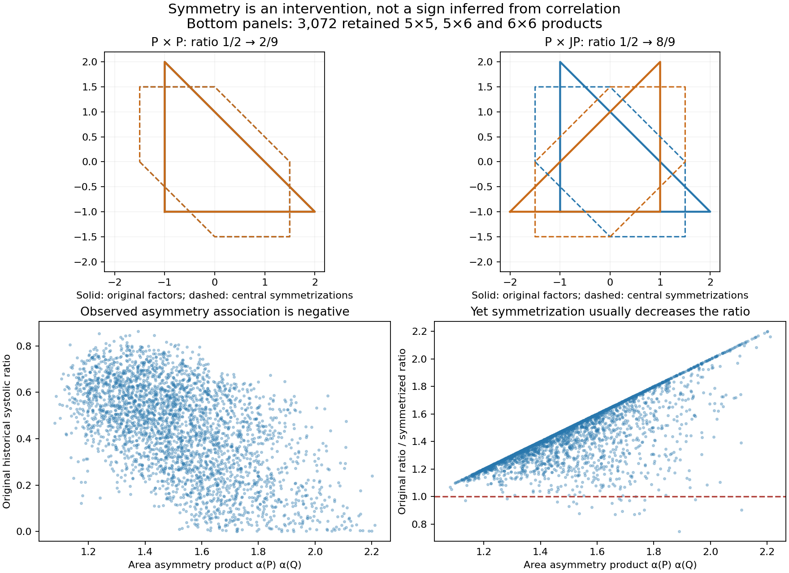
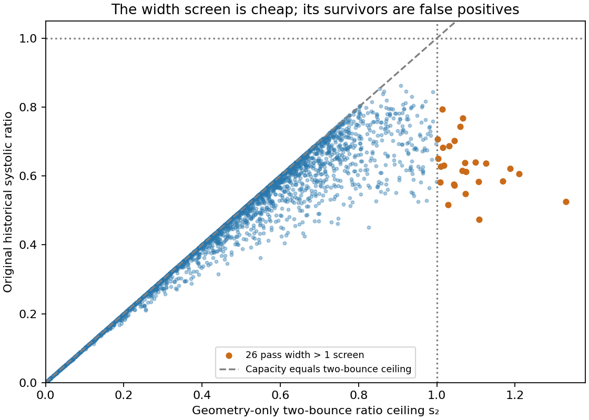
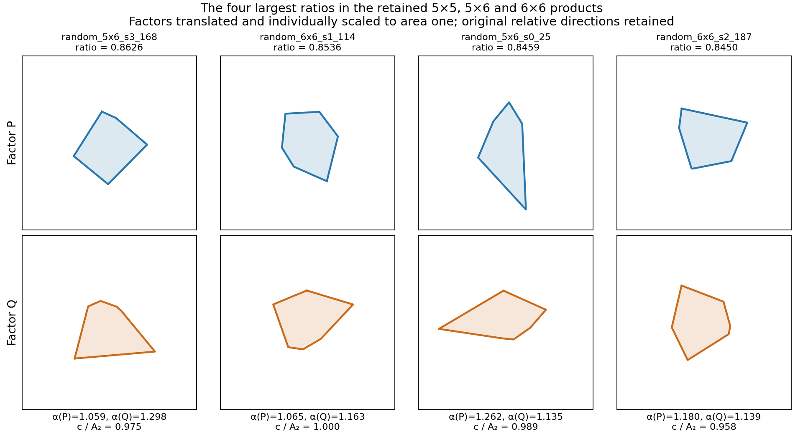

# Central symmetry does not determine an improving direction

Two exact rational controls show that simultaneous central symmetrization can either increase or decrease the systolic ratio, even when the original ratios and the individual factor-asymmetry amounts agree. Across the retained random products, an observational preference for more symmetric factors points in the opposite direction from the usual effect of actually symmetrizing a given pair.



## Exact obstruction

Let

$$
P=\operatorname{conv}\{(-1,-1),(2,-1),(-1,2)\},\qquad
J(x,y)=(-y,x),\qquad S=(P-P)/2.
$$

The capacities and ratios are:

| Product | Capacity | Factor-area product | Systolic ratio |
|---|---:|---:|---:|
| $P\times_LP$ | $9/2$ | $81/4$ | $1/2$ |
| $P\times_LJP$ | $9/2$ | $81/4$ | $1/2$ |
| $S\times_LS$ | $9/2$ | $729/16$ | $2/9$ |
| $S\times_LJS$ | $9$ | $729/16$ | $8/9$ |

Thus the symmetrized/original ratio is **4/9** for the first pair and **16/9** for the second. Each unsymmetrized factor has the same affine-invariant area asymmetry $\alpha(P)=\operatorname{area}(P-P)/(4\operatorname{area}P)=3/2$. Even the original capacity and ratio agree between the two controls. Relative position changes the sign of the symmetry intervention.

The exact verifier [exact_controls.py](exact_controls.py) uses `Fraction`, constructs and checks the rational polar geometry, computes polygon areas by shoelace, and enumerates all 120 cyclic six-facet words for each triangular product. The product closure-vertex reduction makes all six weights equal to 1/6: a triangle's normalized closure is unique, and the optimal two-factor mass split is 1/2–1/2. Both complete maxima are $Q_{\max}=1/9$, hence capacity $9/2$. This is a finite rational verification with a stated completeness reason, independent of the current production capacity evaluator.

For the symmetrized products it computes the exact two-bounce inradius, then uses the **known theorem for two centrally symmetric factors** identifying that inradius with capacity. This theorem is attributed to Artstein-Avidan–Karasev–Ostrover, Eq. (1.4.3)/Remark 4.2, in the retained [source check](../../topics/products/pentagon-arbitrary-partner/source-check.md). This packet does not extend the theorem to one symmetric factor. The original two-bounce geometry is owned by [the existing class proof](../../topics/products/product-two-bounce-class.tex); the product closure reduction is [the existing six-facet proof](../../topics/products/product-qp-six-facet-reduction.tex).

## Why the observational association misleads

For arbitrary planar factors write

$$
A_2=\max\{r:r(Q-Q)^\circ\subseteq P-P\},\qquad
\alpha_P=\frac{\operatorname{area}(P-P)}{4\operatorname{area}P},\quad
\alpha_Q=\frac{\operatorname{area}(Q-Q)}{4\operatorname{area}Q}.
$$

Simultaneous central symmetrization preserves both difference bodies, so the known symmetric-product theorem gives

$$
\frac{\operatorname{sys}(P\times_LQ)}
{\operatorname{sys}((P-P)/2\times_L(Q-Q)/2)}
=\alpha_P\alpha_Q\left(\frac{c(P\times_LQ)}{A_2}\right)^2.
$$

This decomposes the operation into its area cost and its capacity gain. The asymmetry product alone cannot decide which dominates.

A geometry-only scan of **all 10,240** retained products finds a Spearman association of about **−0.517** between area-asymmetry product and historical systolic ratio. Nevertheless simultaneous central symmetrization **decreases** the ratio in **10,117/10,240 (98.80%)**, and increases it in 123. The median original/symmetrized quotient is **1.609**. Among the 3,072 retained 5×5, 5×6 and 6×6 products, symmetrization decreases it in **3,051 (99.32%)** and increases it in 21. These are paired geometric comparisons against a known-capacity transformed product, rather than a regression interpreted as a direction of improvement.

The exact counterexample supplies the obstruction; the retained comparison shows that its lesson is relevant to interpreting this dataset. It does not establish a causal law for a different sample or a universal tendency.

## Width-only selection has a large upper-tail failure



The target-free screen $s_2=A_2^2/(2\operatorname{area}P\operatorname{area}Q)>1$ passes just **26 of the 3,072** retained products in the 5×5, 5×6 and 6×6 buckets: 11, 11 and 4 respectively. Every survivor remains well below one in the historical target: **0.4745–0.7947**, with capacity/inradius quotient **0.6291–0.8851**. The largest width ceiling, **1.32957**, belongs to `random_5x6_s2_220`, whose historical ratio is only **0.52615**. A large width ceiling creates room for a high capacity; the shorter three-bounce competitor can remove that room.

This is a concrete obstruction to optimizing the width ceiling alone. It is not a failure of the inequality $c\leq A_2$, and it does not invalidate using the ceiling for cheap rejection. The two-bounce mechanism and its strong retained association were already established in [the earlier width packet](../../topics/empirical-studies/sys-datascience/methods/product-bounce-width-shortcut/README.md). The new contribution here is the full independently reconstructed geometric screen and the complete, explicitly enumerated set of 26 upper-threshold false positives. No general classification of three-bounce takeover is claimed.

## Evidence and falsification

- **Input identity:** offline `scripts/artifacts.py verify-cache polytope-datasets` verified the three-payload registered snapshot `f7bc6be841e9d30741d5bf7ec8d4f0c0c74ec22745d3325b792e64cec333ca96`. The analyzer independently pins `random-product.jsonl` SHA-256 `66bf82010e92e0f26b0df226f4e6c0eef05d21eb22a0967c7f669530f6545736` and checks unique names and the complete 10,240-row count.
- **Independent geometry:** factor vertices are intersections of cyclic adjacent supporting lines. Convex-hull difference bodies supply the inradius by polar inclusion. A second method directly minimizes the piecewise-linear support function along difference-body edges for a deterministic spread of rows and all 26 eligible width-screen survivors. Counts and maximum discrepancy are in [summary.json](summary.json).
- **Numerical falsifiers:** every row satisfies $c/A_2\leq1$ within `1e-9`; reconstructed factor areas reproduce stored four-volume within `1e-9` relative. The closest original/symmetrized quotient to one is more than `5e-4`, so the 123-vs-10,117 sign count is not a rounding-threshold artifact.
- **Exact controls:** `python3 exact_controls.py` must print `PASS`; it asserts both exact capacities, both transformed ratios and both factors of change. The theorem assumptions are printed alongside the result.
- **Label limit:** the old capacity and systolic-ratio fields are inherited historical numerical targets. Current capacity corroboration is documented by [retrospective revalidation](../../topics/empirical-studies/retrospective-revalidation/README.md); volumes remain numerical. This scan does not certify those targets or their systolic ratios. The rational controls are separate exact mathematical inputs.
- **Novelty limit:** retained source searches found existing fixed-pentagon symmetrization paths and the existing width mechanism. This report claims a new packet-specific control/population synthesis, not literature novelty. No new literature search occurred. Dependency setup through `uv` fetched Python packages (including a 5.1 MiB fonttools wheel); no scientific data, messages or outputs were sent to external services.

## What do the largest retained products look like?



These are the four largest historical ratios among the 3,072 retained 5×5, 5×6 and 6×6 products, not a claim of global near-optimality. Factors are translated and individually rescaled to area one, retaining their relative directions. The highest row has visibly uneven edges and area-asymmetry factors 1.059 and 1.298; the second has 1.065 and 1.163. The picture does not identify one regular-factor family characterizing the winners. A controlled change to regularity is not determined by this ordering. The exact shape-versus-relative-position counterexample above supplies a stronger conclusion than visually classifying these four shapes.

[Raw factor vertices and labels](top-shapes.json) make the panel reproducible through `plot_top_shapes.py --source SOURCE --features patterns/product-shape/features.csv.gz --out /tmp/msc-math/patterns/top-shapes` (run with `uv run`). The plot performs no new capacity calculations.

## Method selection and thesis value

Options considered were (a) rank polygons by affine regularity, (b) fit increasingly elaborate shape regressions, (c) use the known difference-body capacity ceiling to construct paired interventions. A raw fit score would reward the already-known near-target ceiling; a record-ratio criterion would reward tiny numerical polishing. The selected rubric was a falsifiable change in geometric understanding, favoring (c). Quick regularity/asymmetry correlations were useful falsifiers, but were not promoted into geometric laws or a new regression campaign.

Proof prospects: the exact control is already a complete finite rational argument conditional on the named existing product theorems. A universal sign rule for symmetrization is refuted. A useful broader theorem would need relative factor-position or closure-triangle information beyond scalar asymmetry. The 26 width survivors delimit that missing obstruction but do not yet characterize it.

Chapter 8 can use the exact two-control table and the paired-population contrast to explain why an inverse association with asymmetry or ridge geometry does not identify an improving deformation. The width-survivor figure supplies a second useful lesson: a strong global predictor can be misleading precisely where a search needs above-one success. Neither observation requires editing or weakening the later exact HKO chapters.

## Reproduce

```bash
python3 patterns/product-shape/exact_controls.py
uv run patterns/product-shape/analyze.py \
  --source /home/joern/.cache/msc-math/artifacts/polytope-datasets/f7bc6be841e9d30741d5bf7ec8d4f0c0c74ec22745d3325b792e64cec333ca96/files/random-product.jsonl \
  --out /tmp/msc-math/patterns/reproduce-product-shape
```

The `--source` path is explicit; use an independently verified local artifact path in another environment. Only `--out` is written. The original producer and the production capacity evaluator are never called. Selected output includes compressed per-row measurements, a compact summary, the exact-control receipt and two figures.

[review: /root/pattern_review]
