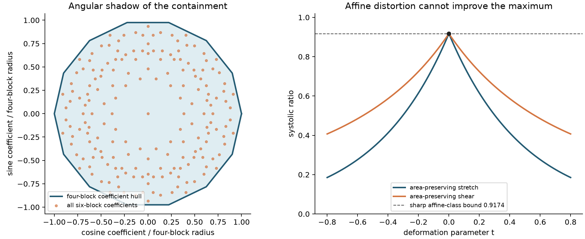

# Independent affine heptagons: a finite containment certificate

**New result in this run:** a computational proof, conditional on the repository's established sparse product reduction, gives an exact capacity formula and sharp systolic bound for *all independent invertible linear images of two regular heptagons*. The retained prior result covered their relative rotations. Novelty outside this repository has not been assessed. The new finite predicate is verified with integer arithmetic; it is not a floating numerical fit. Human proof acceptance remains separate.



## Statement and normalization

Let `P7` have circumradius one, outward unit normals
`n_i=(cos(2πi/7),sin(2πi/7))`, and support height `h=cos(π/7)`. Put `w=1+h`, `S7=(7/2)sin(2π/7)` and `D=conv{±n_i}` (the unit-circumradius regular fourteen-gon). For arbitrary `G,H∈GL(2,R)`, including orientation-reversing maps, define

$$
M=G^{-1}H^{-T},\qquad m(M)=\max_{0\le i,j<7}|n_i^TMn_j|.
$$

Then

$$
\boxed{c_{\rm EHZ}(GP_7\times_L HP_7)=\frac{w^2}{m(M)}},
\qquad
\boxed{\operatorname{sys}(GP_7\times_L HP_7)
 \le \frac{w^4}{2S_7^2}\sec^2(\pi/14)
 =0.9174081964\ldots <1.}
$$

Equality in the ratio holds exactly when `M=t R_(π/14) U`, where `t>0` and `U` is an orthogonal dihedral symmetry of `D`. Thus independent shears and stretches cannot improve the best relative rotation. Translations and separate factor dilations may be included without altering the statement's content.

The capacity convention is `c=1/(2 Qmax)` and the ratio is `c²/(2 area(A) area(B))`. Coordinate order is `(q1,q2,p1,p2)` with `ω((q,p),(q',p'))=q·p'−p·q'`.

## Proof reduced to 48 exact containment predicates

The source dependency is [the six-facet product reduction](../../topics/products/product-qp-six-facet-reduction.tex), together with the four/six-block decomposition proved in Sections 2–3 of [the affine-pentagon research note](../../topics/products/pentagon-affine-products/research.tex). The prior heptagon theorem in that note proves *angular* containment only; no independent-affine conclusion is imported.

1. For factor dual rows `u_i=n_i/h`, a normalized closure is `γ_i≥0`, `Σγ_i=1`, `Σγ_i u_i=0`. Some maximizing product word uses one closure vertex per factor, at most three rows from each, with each factor assigned total weight `1/2`. This is an existence claim, not a classification of all optimizers.
2. Every positive heptagon closure triple has three cyclic gaps, each less than `7/2`, whose sum is seven. Up to rotation the two possibilities are `(1,3,3)` and `(2,2,3)`. Representatives are `(0,3,4)` and `(0,2,4)`. Each has seven rotations and there are no opposite-pair closures. The remaining triples are infeasible or have nonpositive closure weights. Thus the fourteen triples are complete.
3. Write `x_i=γ_i n_i/h` and similarly `y_j`. The normalized four-block tensor body is
   `T4=(1/(2w²)) conv{±n_i n_j^T}` because `(P7−P7)°=D/w`. A six-block alternating word has tensor
   `T6=(1/2)(x_0 y_0^T−x_2 y_1^T)`. Cyclically cut at the first (distinguished) row of the q-triple. The two orders of its other rows and all six p-orders give twelve cases per triple pair. Independent rotations of either triple act by left/right orthogonal multiplication and preserve `T4`. Consequently the two closure types per factor leave exactly `2·2·12=48` representative tensors to check. No reflection quotient is used.
4. For each representative the certificate lists four signed rank-one atoms `v_k=±n_i n_j^T`. The integer-only verifier encloses the **exact** coefficients of the nonsingular linear system
   `Σ a_k v_k = w²(x_0 y_0^T−x_2 y_1^T)`
   and proves `Σ |a_k| < 24/25`. Since `conv{±n_i n_j^T}` is centrally symmetric and contains zero, these inequalities imply
   `T6 ⊂ (24/25) T4` for the full six-block set. Four-block tensors already attain the support of `T4`; two-block words have zero objective. The sparse reduction therefore identifies the full `Qmax` with the support function of `T4`, at every matrix argument.
5. Under independent affine maps, dual rows and steps become `G^{-T}x` and `H^{-T}y`; both tensor bodies transform by the same invertible linear map `T↦G^{-T}TH^{-1}`. Containment survives, including when either determinant is negative. Evaluating transformed rank-one generators against the identity gives
   `Qmax=m(G^{-1}H^{-T})/(2w²)`. The reciprocal capacity convention proves the capacity formula. This includes both sides of equality: no six-block competitor improves the four-block support, and every generating four-block tensor is feasible by the width-step lemma in the cited source.
6. Areas multiply by `|det G|` and `|det H|`, hence
   `sys=(w⁴/(2S7²)) |det M|/m(M)²`. Set `L=M/m(M)`. The pairing definition implies `LD⊂D°`, and `D°=sec(π/14) R_(π/14) D`. Comparing areas gives `|det L|≤sec²(π/14)`. Equality of areas of nested convex bodies forces equality of the bodies. Therefore `cos(π/14) R_(-π/14)L` is a linear automorphism of a regular fourteen-gon; permutation of cyclic adjacency makes it a dihedral orthogonal symmetry. Conversely the stated matrices attain equality. The numerical display is illustrative; the interval verifier certifies the exact sharp expression is less than one.

For the illustrated deformations, the relative matrix is `M=R_(π/14) diag(e^t,e^(-t))` (stretch) or `M=R_(π/14) [[1,t],[0,1]]` (shear). The angular projection is an illustration; the certificate checks four tensor coordinates.

The interval verifier also checks the displayed ratio is less than one by direct rational interval evaluation (added alongside the containment predicates). The sharp bound's derivation uses the same elementary regular-polygon area argument as the prior affine-pentagon theorem, with fourteen replacing ten.

## What the exact verifier trusts

`certificate.py verify heptagon-certificate.json` uses only Python's standard library. It constructs a dyadic interval for π using Machin's identity `π=16 atan(1/5)−4 atan(1/239)` and 100-term alternating rational arctangent series. Directed integer rounding encloses every addition, multiplication and division at 160 fractional bits. Sin/cos use Taylor recurrences through degrees 99/100; the rational Lagrange remainder bound `7^101/101!` applies because every angle has absolute value below seven. The positive closure coefficients are evaluated from the three cross products divided by their positive sum. Interval Gaussian elimination encloses the exact four coefficients; all pivots are checked to exclude zero. Summed upper bounds on their absolute values are compared against `24/25` by integers. The case list is checked against the complete 48-element combinatorial product, not just its length.

The LP discovery script is in the same file for reproducibility, but neither its coefficients, optimality, floating trigonometry nor SciPy's hull computations are trusted by verification. Only four atom indices per case are retained. `24/25` is a convenient slack bound, not an optimized scientific result; its role is strict containment. A numerical discovery maximum near `0.9577874344` guides this slack choice.

## Breadth-first falsification and selection

Before this proof, [scan.json](scan.json) evaluated all 55 unordered pairs `3≤n≤m≤12` using all positive three-row closures and twelve alternating orders. It compares six-block coefficients with the regular four-block angular polygon. For even factors, opposite-pair closures contribute to four blocks; there are no extra six-block cases from them.

- Universal width-body equality fails strongly for triangle partners: gauges `2` for `3×3`, `1.236067977` for `3×5`, `1.177183626` for `3×7`. These observations were not selected as new theorems because the triangle obstruction already exists in the retained research note.
- Every tested pair with both counts at least five satisfies angular containment numerically. This supports, but does not prove, the already recorded odd-regular conjecture.
- [tensor.json](tensor.json) screened the stronger full four-dimensional containment for ten odd pairs. All passed numerically. `5×7` has a small strict margin, whereas `7×7` has comfortable margin and only two closure types.
- The selected outcome is the exact `7×7` certificate, because it answers a previously unresolved structural question: whether arbitrary affine distortions can create a genuinely six-block capacity branch. They cannot. Additional `9×9` or `11×11` numerical margins were not pursued as scientific results.

Method choice compared: (A) denser angular sampling (cannot settle the affine question); (B) exact full tensor-hull facet enumeration (valid but much larger proof surface); (C) sparse convex-combination witnesses with an independent exact verifier (selected: 48 systems, elementary acceptance conditions). Rubrics considered were raw sweep coverage (rewards uninformative sampling), decimal tightness (rewards polishing), and consequence per auditable predicate (best aligns with closing the affine obstruction). Discovery and verification are deliberately distinct.

## Reproduction and evidence limits

From the repository root:

```sh
python patterns/regular/certificate.py verify patterns/regular/heptagon-certificate.json
OPENBLAS_NUM_THREADS=1 uv run --offline --with numpy --with scipy python patterns/regular/certificate.py discover /tmp/heptagon-certificate.json
python patterns/regular/certificate.py verify /tmp/heptagon-certificate.json
OPENBLAS_NUM_THREADS=1 python patterns/regular/scan.py
OPENBLAS_NUM_THREADS=1 uv run --offline --with numpy --with scipy python patterns/regular/tensor.py
uv run --offline --with numpy --with matplotlib python patterns/regular/figure.py
```

Discovery commands overwrite adjacent `scan.json`/`tensor.json`; use a scratch copy to preserve retained bytes. The exact verifier is read-only. `verification.json` records its result. No thesis sources were edited. The proof applies to affinely regular heptagons, not arbitrary heptagons or all fourteen-facet four-polytopes. The general odd-regular tensor-containment theorem remains open here. The certificate supplies the finite containment implication; correctness of the imported sparse reduction and of the small verifier remain mathematical/code review obligations.

[review: /root/regular_review]
