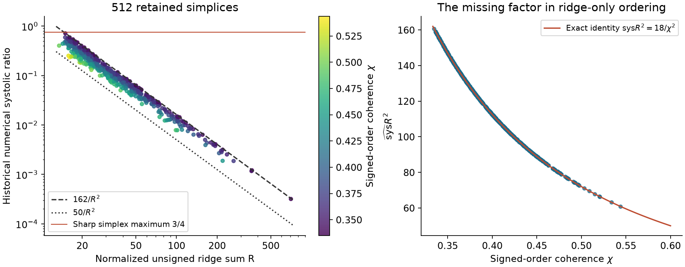

# A signed ridge invariant explains the simplex stratum exactly

For every full-dimensional four-simplex, the unsigned ridge sum misses an ordering factor. Recovering the signed symplectic ridge circulation yields an exact identity and sharp bounds:

$$
 \operatorname{sys}(K)=\frac{18}{\chi(K)^2 R(K)^2},\qquad
 \frac13\leq\chi(K)\leq\frac35,\qquad
 50\leq\operatorname{sys}(K)R(K)^2\leq162.
$$

Both envelope endpoints are attained. A separate consequence is the sharp simplex maximum $\operatorname{sys}(K)\leq3/4$, attained by the ordinary coordinate simplex. This run rederives these statements from the repository's HK formula plus one small exact polytope certificate. It makes no literature novelty assertion; a targeted retained-source search did not find this simplex-stratum explanation in the selected chapter or empirical accounts.



## Definition and explanation

Translate the interior origin into the simplex and write its five inequalities as $a_i\cdot x\leq1$. There is one positive normalized closure vector $\beta$ satisfying $\sum\beta_i=1$, $\sum\beta_i a_i=0$. Put

$$
 g_i=\beta_i a_i,\quad B_{ij}=\omega(g_i,g_j),\quad
 Q=\max_{\sigma}\sum_{i<j}B_{\sigma_i\sigma_j},\quad
 S_B=\sum_{i<j}|B_{ij}|,\quad\chi=Q/S_B.
$$

Closure makes cyclic cuts irrelevant, so exactly 24 orders suffice. Every row of the skew matrix $B$ sums to zero. Its unsigned entries are precisely the ten ridge areas divided by $12V$. The missing information in $R$ is the coherent signing and its arrangement on the facet graph, rather than the number or size of the ridges alone. Both $\chi$ and $R$ respect translation, scaling and linear symplectic changes.

The HK formula becomes $c=1/(2Q)$, whereas $R=12\sqrt V S_B$, proving the identity. Thus the ridge-only inverse-square relationship has a factor varying by as much as $162/50=3.24$ even at a fixed combinatorial type. This is an exact explanatory decomposition, **not an independent cheap substitute for capacity evaluation**: evaluating $\chi$ performs the simplex's complete HK ordering problem.

## Exact equal-ridge counterexample

The stronger claim that *any* function of unsigned ridge sum determines the ratio also fails. [ridge_controls.py](ridge_controls.py) constructs two rational simplices with identical volume $V=1/192$ and identical $R^2=363$, but capacities $1/20$ and $1/16$, hence ratios **6/25** and **3/8**. It checks all vertices against all inequalities, computes exact volume and each ridge area, and exhausts all 24 cyclic capacity orders. This provides equal-input/different-output controls, rather than inferring insufficiency merely from a varying correction factor. The rational dual rows and results are in [ridge-controls.json](ridge-controls.json).

## What is proved and checked

[PROOF.md](PROOF.md) supplies the full argument. Barycentric gradients give $|\operatorname{Pf}(B_{0:4,0:4})|=1/(24V)$. The unit ball of $Q$, a six-dimensional 24-halfspace polytope, is exactly the convex hull of the 20 directed triangle circulations. [exact_polytope.py](exact_polytope.py) proves that finite lemma with integer elimination and rational back substitution over all **134,596** six-row active bases; there are **31,616** nonsingular bases and precisely the twenty stated feasible vertices. It checks exact rational types, opposite inequalities and full rank, ensuring boundedness and completeness.

A short triangle-free graph argument bounds the Pfaffian by $Q^2/4$, giving the sharp $3/4$ ratio bound. Triangle-circulation convexity and directed-cycle decomposition give the two sharp $\chi$ bounds. The ordinary simplex attains $\chi=1/3$; a nondegenerate five-cycle circulation attains $\chi=3/5$. The proof explicitly establishes geometric realizability of that circulation.

The new scan independently reconstructs all **512** five-facet rows from the registered historical generic source. Maximum capacity relative discrepancy is **8.33×10⁻¹⁵**; maximum ridge-sum relative discrepancy is **4.00×10⁻¹⁵**; maximum ratio absolute discrepancy is **3.11×10⁻¹⁵**. Their largest historical ratio is **0.7144103639**, so the sharp simplex bound explains an entire facet bucket rather than extrapolating its observed maximum. Full numerical results are in [scan.json](scan.json), and compact per-row values in [rows.json](rows.json).

The floating reconstruction corroborates the formulas and implementation correspondence on these inputs; it does not certify historical capacities or volumes. The exact proof concerns mathematical simplices and does not depend on the historical labels. The source normalization and completeness assumptions are imported from [the HK account](../../topics/capacity-and-qp/README.md). No claim covers general six-or-more-facet polytopes or classifies every equality simplex.

## Cheap falsification loop

Initial candidate: unsigned ridge sum alone should determine a simplex's ratio. Reconstructing the signed circulation revealed an omitted ordering factor. The exact equal-R pair then refuted that simple law; the nonconstant sharp range alone would only refute a constant inverse-square coefficient. Random local constrained optimization suggested $3/4$, but was discarded as proof; numerical vertex enumeration was also replaced by complete rational enumeration. The certificate, barycentric determinant identity, direct ridge formula, and all-row comparison test different implications. The successful outcome is the exact stratum-specific explanation and sharp envelope, not a decimal improvement of the largest sample.

Method selection compared regression on more unsigned moments, complete simplex HK reconstruction, and large generic sampling. A fit-score rubric rewards a target-leaking reconstruction; a best-sample rubric rewards no theorem. The chosen rubric was explanatory gain with complete falsifiability: reconstruct the 24-order mechanism, then separate its exact theorem from its numerical reproduction.

## Reproduce

```bash
python3 patterns/simplex/ridge_controls.py
python3 patterns/simplex/exact_polytope.py > /tmp/msc-math/patterns/simplex-certificate.json
uv run --offline patterns/simplex/analyze.py \
  --source /path/to/verified/polytope-datasets/files/random.jsonl \
  --output /tmp/msc-math/patterns/simplex-reproduction
```

The exact certificate uses the standard library and prints JSON only. The analyzer pins the source SHA-256, joins the retained current-schema gzip tables, and writes only to its explicit output directory. NumPy and Matplotlib are declared inline. Use `scripts/artifacts.py verify-cache polytope-datasets` to identify a verified local source path; no producer rerun is needed. Exact output timing varies. The five-facet data and this proof are relevant to chapter 8; the longer finite proof is better kept as accompanying evidence.

[review: /root/simplex_proof]
