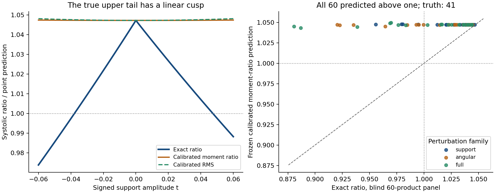

# The upper tail needs a cusp: fixed action moments miss its first-order loss

17 October 2026. **Every end-to-end continuously differentiable, rotation-invariant scalar predictor calibrated at HKO misses the first-order systolic deficit on an explicit nonregular support deformation.** This is a local approximation obstruction, rather than an impossibility theorem for arbitrary functions of smooth features. A nonsmooth outer rule can recover a cusp from smooth data.

A new target-free closure-action moment ceiling is valid for every planar polygon product, but is **22.38% too large at HKO**. Its two frozen HKO-calibrated point predictors fail the blind 60-product challenge: both predict all 60 ratios above one, while exactly 41 are above one. Their errors on those 41 are essentially the constant-HKO baseline, and their rankings are poor. The exact deformation below explains the failure: every fixed finite action moment changes quadratically, while capacity and ratio change linearly.



## The general differentiability obstruction

Put $n_i=(\cos(2\pi i/5),\sin(2\pi i/5))$, $b=\cos(\pi/5)$, $\varphi=(1+\sqrt5)/2$, and $\rho_*=(3+\sqrt5)/5$. Define

$$P_h=\{x:n_i\cdot x\le h_i\},\quad P_0=P_{\boldsymbol1},\quad
 Q=\sin(2\pi/5)JP_0,\quad d_i=\cos(4\pi i/5),\quad h(t)=\boldsymbol1+td.$$

These are genuine pentagons for $|t|<1/\varphi$. The fixed partner is at the HKO relative angle; for every sufficiently small nonzero $t$, the deformed product is nonregular and still has ratio greater than one. The [exact capacity-core control](../mixed-area-global/REPORT.md) gives

$$\rho(t)=\begin{cases}
\displaystyle\rho_*\frac{(1-t/2)^2}{1-bt^2},&t\ge0,\\[3pt]
\displaystyle\rho_*\frac{(1+t/\varphi)^2}{1-bt^2},&t\le0.
\end{cases}\tag{1}$$

**Theorem.** Let $F(h)$ be a scalar score defined near $\boldsymbol1$, invariant under cyclic permutation of the five support coordinates. Suppose it is differentiable at $\boldsymbol1$ and $F(\boldsymbol1)=\rho_*$. Then, as $t\downarrow0$,

$$\begin{aligned}
F(h(t))-\rho(t)&=\rho_*t+o(t),\\
F(h(-t))-\rho(-t)&=\frac{2\rho_*}{\varphi}t+o(t).
\end{aligned}\tag{2}$$

In particular it cannot approximate this upper tail with error $o(|t|)$.

**Proof.** If $S$ is the cyclic shift, differentiating $F(Sh)=F(h)$ at the fixed point $\boldsymbol1$ gives $DF(d)=DF(S^kd)$ for every $k$. Since $\sum_{k=0}^4S^kd=0$, linearity gives $DF(d)=0$. Hence $F(h(\pm t))=\rho_*+o(t)$. Expanding (1) proves (2). ∎

A simultaneous 72-degree rotation of both factors is orthogonal and symplectic, fixes $Q$, and cyclically shifts these supports. Thus every differentiable geometric scalar invariant under that rotation satisfies the hypothesis. The same conclusion applies to any finite collection of differentiable invariant scalar features followed by a differentiable calibration map. It does **not** rule out a nonsmooth predictor, a nonsmooth invariant, an equivariant vector of shape features, or good approximation away from the limiting point. For example a square root of a quadratic defect can reveal $|t|$; phase is then still needed to distinguish the two slopes in (1).

This identifies an actual mechanism behind failed smooth models at the upper tail. A maximum or minimum of competing geometric contacts can retain the required first-order kink. Adding finitely many moments through another smooth fit cannot remove this obstruction.

## A target-free moment ceiling and its frozen predictors

For a polygon with irredundant facet covectors $a_i$, let $C_A=\{\alpha\ge0:\sum\alpha_i=1,\sum\alpha_i a_i=0\}$. Use the uniform probability on its distinct vertices; each has support at most three. Define $C_B$ similarly. For each of the two full angular shadow words, reverse the negative shadow and put

$$H_s(i,j)=\frac14\varepsilon_{ij}(s)a_i\cdot b_j,\qquad
X_s=\alpha^TH_s\gamma.$$

The [two-shadow theorem](../mixed-area-order/REPORT.md) and convex edge-polygon construction give $X_s\ge0$: it is a mixed area, including degenerate segment cases. Let $m_{p,s}=\mathbb E[X_s^p]$. The first and second moments are calculated from the separate factor tensors:

$$m_{1,s}=\mu_A^TH_s\mu_B,\qquad
m_{2,s}=\sum_{i,j,k,l}H_s(i,j)H_s(k,l)
\mathbb E[\alpha_i\alpha_k]\mathbb E[\gamma_j\gamma_l].$$

No pairwise maximum, action minimizer, capacity label or fitted coefficient enters these features. Individual factor closure vertices are enumerated, but their Cartesian product is not used by the predictor. This is a product-class invariant: relabeling, translation, independent scaling after ratio normalization, and product-preserving linear symplectic coordinate changes preserve it. No extension to arbitrary nonproduct bodies is asserted.

Let $M$ denote the full maximal HK objective. Since $0\le X_s\le M$, $m_{2,s}\le M m_{1,s}$. Therefore

$$L=\max_s\frac{m_{2,s}}{m_{1,s}},\qquad
\boxed{\operatorname{sys}(P\times_LQ)\le B(P,Q)=\frac1{8A(P)A(Q)L^2}.}\tag{3}$$

The positive first moments make the quotients well defined. This is an aggregate certificate inequality, not a new capacity algorithm. At HKO, exact arithmetic gives

$$B_* =\frac{698+312\sqrt5}{1089}=1.2815915601\ldots,
\qquad\frac{B_*}{\rho_*}=1.2238110407\ldots.$$

The gap is too large to suggest an HKO-sharp global bound.

Before reading any fresh truth, the frozen point predictions were

$$I_B=\rho_*\frac{B}{B_*},\qquad
I_{\rm RMS}=\rho_*\frac{V_*\max_s m_{2,s,*}}{V\max_s m_{2,s}}.\tag{4}$$

Here $V=A(P)A(Q)$ and stars denote the known regular HKO control. **After calibration, (4) consists of point predictions; the ceiling guarantee applies only to (3).** There was no fit, clipping, support response or post-score correction.

## Why every fixed finite action moment misses this cusp

The five normalized closures of the undeformed regular normal fan are cyclic translates of $\lambda=(1,1,0,\varphi,0)/(2+\varphi)$. Their support loads are the multiset

$$\ell_j=\lambda^{(j)}\cdot d\in
\left\{a,-\tfrac12,\tfrac1\varphi,-\tfrac12,a\right\},
\qquad a=\frac{3-\sqrt5}{4}.$$

They satisfy $\frac15\sum\ell_j=0$ and $\frac15\sum\ell_j^2=a$. Under deformation, the covectors are $a_i(t)=n_i/h_i(t)$ and the corresponding normalized closure is

$$\alpha_i^{(j)}(t)=\frac{\lambda_i^{(j)}h_i(t)}{1+t\ell_j}.$$

Its weighted edge polygon is precisely its old polygon divided by $1+t\ell_j$. Supports and their number stay fixed. Thus every action in row $j$ is divided by $1+t\ell_j$. At HKO, cyclic rotation permutes the other factor's closure vertices, so each row has the same $p$th action moment for either shadow. Consequently, for every fixed finite $p>0$,

$$\boxed{m_{p,s}(t)=m_{p,s}(0)S_p(t),\qquad
S_p(t)=\frac15\sum_{j=0}^4(1+t\ell_j)^{-p}.}\tag{5}$$

In particular $S_p(t)=1+\frac{p(p+1)}2a t^2+O(t^3)$ and every such moment is first-order flat. The two-shadow maxima in (4) do not create a kink on this path: (5) multiplies both shadows by the same positive factor. With the exact area $V(t)=V_*(1-bt^2)$,

$$\begin{aligned}
\frac{I_B(t)}{\rho_*}
 &=\frac{S_1(t)^2}{(1-bt^2)S_2(t)^2}
 =1+\frac{5\sqrt5-11}{4}t^2+O(t^3),\\
\frac{I_{\rm RMS}(t)}{\rho_*}
 &=\frac1{(1-bt^2)S_2(t)}
 =1+(\sqrt5-2)t^2+O(t^3).
\end{aligned}\tag{6}$$

Both quadratic coefficients are positive: these two predictors initially rise while the exact ratio falls linearly. For $t=1/32$, truth is $1.0155461760$ and the moment-ratio prediction is $1.0472598866$; for $t=-1/32$, truth is $1.0079497072$ and the prediction is $1.0472598830$. Both bodies are above one. Formula (5), rather than an additional regression, explains why finitely many smoothly combined action moments cannot supply the missing first-order loss.

## Blind 60-product result

The [contact-stability panel](../contact-stability/REPORT.md) fixes five independent directions, three perturbation families (support/angular/full), and four amplitudes. Geometry and membership were fixed independently of capacity. The entire action prediction file was frozen with SHA256 `df835152aa3211ada0a1966bd6f85eb7c6171564bf0aa8ee03d8b8426868cb64` before this owner read any fresh truth. The oracle artifact had already been produced by the separate owner before this freeze; its contents were still unseen here. Accordingly this is an **unseen-label frozen-model challenge**, not a claim that the prediction freeze preceded oracle computation.

| Frozen predictor | All 60 relative MAE | Above-one 41 relative MAE | Above-one Spearman | Above-one predicted |
|---|---:|---:|---:|---:|
| Calibrated moment ratio | 3.8149% | 1.2976% | −0.0627 | 60/60 |
| Calibrated RMS | 3.8596% | 1.3017% | −0.3606 | 60/60 |
| Constant known HKO ratio | 3.8300% | 1.2978% | — | 60/60 |

The support-only family's Spearman values are −0.9579 and −0.9759. Worst all-panel relative errors are 18.67% and 18.89%. Low error on the fifteen largest ratios (about 0.337% for either predictor and the constant baseline) reflects closeness to HKO, with no useful ranking advantage. This constructed local panel is not a population estimate, a generic-body test or a family-held-out corpus comparison. The exact obstruction and failure against a constant stop this candidate without an expanded scan or additional moments.

## Choice, verification and source limits

[PLAN.md](PLAN.md) compares three real mechanisms before the moment pilot: mean width/quermass geometry, cuts-extremizer/coverage dynamics, and factorized closure-game moments. A bulk-fit rubric rewards degeneration; regular controls reward already known formulas; tiny bound cuts reward polishing. HKO inflation, blind nonregular upper-tail discrimination and an exact mechanism were the discriminants.

The primary-source audit found that [Haim-Kislev's nonsmooth Zoll paper](https://arxiv.org/html/2511.16644v1) distinguishes cuts extremality from coverage and cuts additivity; coverage by minimizers alone does not imply local maximality, and its numerical cut experiments suggest that HKO itself is not cuts additive. Thus a naive coverage score has no asserted sufficiency. [Ahn–Kerman's mean-width note](https://arxiv.org/html/2602.07220v1) gives a general mean-width capacity ceiling and discusses symplectic optimization; ordinary rotational mean width cannot see relative factor rotation. Its optimized version is a different, nontrivial problem, not a tested invariant here. [Balitskiy–Mitrofanov–Polyanskii](https://arxiv.org/html/2603.12495v1) supplies relevant triangle-cover geometry; the capacity-core implication used in (1) is the already retained repository theorem, not a new literature result from this packet.

[verify.py](verify.py) uses an independent closure solver and genuine four-dimensional HK forward sums to check all 3,000 actions underlying the 60 first/second moment pairs. It checks exact nonnegativity, tensor identities, ceilings against exact truth, 24 relabel/translation/product-symplectic controls, exact HKO inflation, exact load/expansion identities, and (5)–(6) at six nonregular algebraic controls. [verification.json](verification.json) records PASS. The theorem is the symmetry and scaling proof above, not an inference from finite checks. The plot was rendered using the existing cached Matplotlib environment and visually inspected.

```sh
python3 -B patterns/upper-tail/action-spectrum/verify.py \
 --sample patterns/upper-tail/contact-stability/sample.json \
 --truth patterns/upper-tail/contact-stability/truth.json
python3 -B patterns/upper-tail/action-spectrum/analyze.py \
 --sample patterns/upper-tail/contact-stability/sample.json \
 --out /tmp/msc-math/upper-tail-20261017/action-replay.json
```

The original freeze sources are preserved under `frozen-source/`; current scripts only add portable input/output paths. A replay reproduced every frozen rational moment and scalar prediction exactly. [scores.json](scores.json) contains all per-body scalar outcomes; [predictions.json](predictions.json) preserves the original large rational tensors' contractions. No new capacity producer, expensive scan, corpus fitting, installation, cloud job, manuscript edit, push or external action was performed. Root owns scientific review, gallery integration and commit; no human acceptance or external novelty determination is claimed.

[review: /root/review_spectra]
