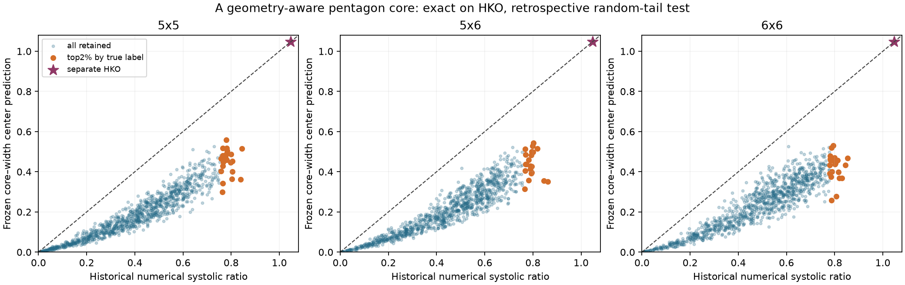
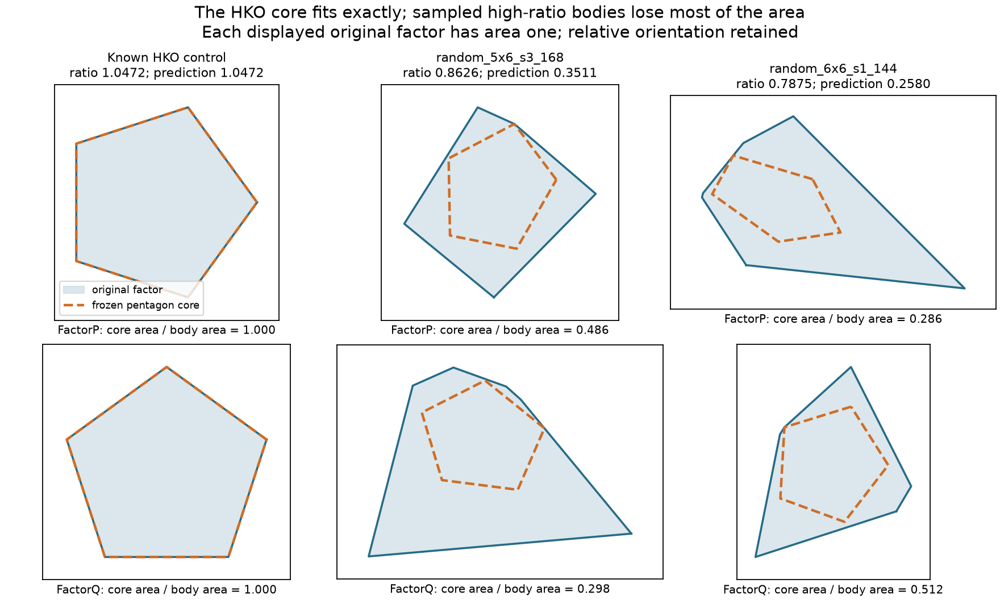

# An inscribed affine-pentagon core fits HKO but fails the random upper tails

**Decision: stop this frozen rule without tuning.** The new geometry-aware feature retains the known HKO ratio above one, but its parameter-free point predictor improves **none of the 63** principal top-2% cases over width. Family-median absolute relative capacity errors are **23–26%**, compared with **3–8%** for width. This is a verified retrospective diagnostic of a genuinely new candidate, not the desired positive upper-tail predictor and not another unsigned-area information-loss example.



## The new feature and its geometric mechanism

For each planar factor, fit a centered inscribed affine image of the regular pentagon by a fixed geometric rule. With extreme vertices $x_i$, put

$$
m=\frac1n\sum_i x_i,\qquad C=\frac2n\sum_i(x_i-m)(x_i-m)^T,\qquad B=C^{1/2}.
$$

Whiten by $y_i=B^{-1}(x_i-m)$. Candidate template phases are exactly the whitened vertex angles modulo $2\pi/5$, at most six choices in these families. For each phase, the largest scale fitting a regular pentagon inside all original supporting halfplanes is an explicit minimum of support ratios. Keep the largest scale, breaking relative $10^{-12}$ ties by smallest phase. No phase grid, learned constant, support addition, target-selected orientation or later variant is used. The retained [PLAN.md](PLAN.md) froze this definition before this run loaded diagnostic labels.

The selected cores are $m+GP_5$ and $n+HP_5$. With base pentagon vertices at angles $2\pi j/5$, use outward normals $u_j$ at $\pi/5+2\pi j/5$. The **existing** affine-pentagon theorem gives

$$
 L=\frac{(1+\cos(\pi/5))^2}
 {\max_{i,j}|u_i^TG^{-1}H^{-T}u_j|}.
$$

In exact arithmetic, containment and monotonicity imply $L\leq c(K\times_L T)$. This is a new compact geometric **lower feature**, not a new capacity theorem or signed HK support enumeration. It includes shape, centering and relative position that the complete unsigned ridge list omits. Construction uses at most six geometric phase candidates per factor and one 25-pair formula; no original-body capacity evaluator is called.

The frozen point predictor is $\widehat c=\sqrt{LW}$, where $W$ is the existing two-bounce width ceiling. It is the multiplicative minimax center of the formal bracket $[L,W]$; this principle fixes the combination without a fitted coefficient. Its ratio prediction is $\widehat{\rm sys}=LW/(2V)$. The raw $L$ errors and bracket span are also retained, so centering cannot conceal a poor core. The floating computed $L,W$ are numerical surrogates for that mathematical construction, **not certified numerical bounds**.

For an independently affine regular pentagon, covariance whitening recovers a regular pentagon, and the phase candidates recover the original body. Thus both cores fit exactly, $L=W=c$, including HKO. This supplied a plausible positive mechanism: high ratio might be explained by a near-HKO affine pentagon product already fitting inside the sampled body with little area loss. The actual upper-tail diagnostic kills this particular implementation of that explanation.

## Principal benchmark: every top-2% case is worse than width

The fixed benchmark selects the 21 largest historical numerical ratios in each of the 5×5, 5×6 and 6×6 buckets (descending ratio, ties by ascending source name). All 3,072 rows in these buckets are evaluated, not only earlier width survivors. Errors below are absolute relative **capacity** errors.

| Bucket | n | Center median | Center 90th | Center worst | Width median | Width worst | Center beats width |
|---|---:|---:|---:|---:|---:|---:|---:|
| 5×5 | 21 | 23.31% | 33.11% | 37.32% | 7.55% | 12.79% | 0/21 |
| 5×6 | 21 | 24.79% | 35.09% | 36.20% | 4.62% | 17.82% | 0/21 |
| 6×6 | 21 | 25.89% | 33.48% | 42.77% | 3.23% | 8.14% | 0/21 |

All center errors in these tails are underestimates. Absolute capacity MAEs in the retained source's scale are **1.2946, 1.3230, 1.4048**, versus **0.3570, 0.2426, 0.1811** for width: **3.63, 5.45, 7.76 times worse**. Absolute systolic-ratio MAEs are **0.3362, 0.3530, 0.3783**, versus **0.1091, 0.0804, 0.0593**. [summary.json](summary.json) contains the full capacity/ratio error summaries, rank correlations and named worst cases; [rows.jsonl.gz](rows.jsonl.gz) retains every fitted matrix and scalar prediction.

A label-independent SHA-256(name) partition, frozen before the test, assigns 2,013 rows to calibration and 8,227 to diagnostic; no parameter is fitted in either. The diagnostic subset contains 15, 17 and 15 of the three principal tails. It also has **0/47 improvements**, with median capacity errors **24.99%, 26.31%, 25.46%**. The corpus's labels were already explored by earlier work, so this partition is **not prospectively held out**. Both all-row tails and the diagnostic subset are explicitly retrospective.

## The failure is geometric area loss, not just a missed angle



Let $\eta_P,\eta_Q$ denote core-area/original-area fractions, and let $s_{\rm core}$ be the exact family's ratio using its **own** core volume. Then the formal lower ratio is

$$
 \frac{L^2}{2V}=\eta_P\eta_Q\,s_{\rm core}
 \leq\eta_P\eta_Q\,\frac{3+\sqrt5}{5}.
$$

The two ingredients—how much volume the fitted cores retain and their internal relative-position quality—are separated by this identity. The upper bound imports the existing sharp affine-pentagon theorem; it is not another fitted law.

| Principal top 2% | Median product coverage $\eta_P\eta_Q$ | Median internal core ratio | Largest $(\eta_P\eta_Q\,s_{\rm HKO})/s_{\rm historical}$ |
|---|---:|---:|---:|
| 5×5 | 0.2833 | 0.8410 | 0.5759 |
| 5×6 | 0.2693 | 0.8703 | 0.5352 |
| 6×6 | 0.2806 | 0.8269 | 0.4897 |

For **all 63 chosen fits**, even replacing the internal core ratio by the sharp HKO maximum would leave its raw lower ratio below the historical target. The last column quantifies this: the area loss alone is already too large. This comparison diagnoses the fixed cores against numerical labels; it does **not** show that every possible inscribed affine pentagon has similarly poor coverage, or that high-ratio products cannot have a better center/affine shape. No such new fit was attempted after seeing these failures.

The largest retained product, `random_5x6_s3_168`, has historical ratio **0.862586** but center prediction **0.351135**; its selected cores cover about **0.486** and **0.298** of the respective factor areas. The worst principal-tail capacity miss, `random_6x6_s1_144`, has ratio **0.787542** and prediction **0.257955**. Their shapes are shown alongside HKO. This defeats the proposed compact core mechanism on actual high-ratio examples, while explaining why success on the regular control was insufficient.

## HKO, bulk and transfer failures

The separate numerical HKO control returns **1.047213595499957**, matching $(3+\sqrt5)/5$ within $10^{-12}$. Nine regular-pentagon rotation controls also match their imported exact capacity profile within $10^{-12}$. HKO is not a random sample or part of tail selection. Its exact reproduction is a necessary control, not evidence of random-tail accuracy.

Across all **10,240** products, the center's median absolute relative capacity error is **35.32%**, versus **0.78%** for width. Only **508/10,240** cases improve in absolute capacity error; total capacity MAE is **5.79 times worse**. Transfer controls are also retained for all seven buckets with a triangle or quadrilateral factor. The 3×3 top tail improves on width in 16/21 cases, but the 4×5 and 4×6 tails improve in none, and this localized gain does not rescue the principal-family failures. No favorable subset was used to select the rule.

## Prior comparison and route decision

Three distinct mechanisms were compared before evaluation; [PLAN.md](PLAN.md) and [scout.md](scout.md) retain the full comparison and source limits.

1. **Outer affine-pentagon templates:** reject analytically. Every such template pair has capacity equal to its own width value. Since width is monotone in both factor inclusions, its capacity is at least the original width baseline. It cannot tighten width. A rubric rewarding rigor and HKO agreement alone would select a vacuous bound.
2. **Inner affine-pentagon core:** selected for its new containment mechanism, exact affine-family behavior and low geometric cost. A rubric rewarding only control recovery could still select a poor approximation; the actual random tails and bulk expose that failure.
3. **Scalar Minkowski-asymmetry correction:** loses relative-position information and risks removing HKO's excess with an arbitrary penalty. Low cost alone can reward missing information or endpoint tuning. It was not tested as a second numerical variant.

The prior stopped minimum-area outer-triangle rule, unsigned-list reconstruction, odd-cross-moment correction and further regular-polygon extensions were not restarted. The selected core feature was not found in the inspected current source account. No exhaustive repository/literature search or external novelty claim is made.

**Disposition:** this specific covariance-centered, vertex-anchor pentagon-core feature and its parameter-free bracket center are stopped. The run produces no successful upper-tail predictor, no claim of global maximality, and no manuscript proposal. It does not rule out all geometry-aware weighted ridges, all core approximations, or approximation from unsigned data. No phase/support refinements, fitted constants or new variants are selected by this failure.

## Verification, cost and reproduction

One feature execution covered all 10,240 products in **9.55 seconds**, with pinned original source SHA-256 `66bf82010e92e0f26b0df226f4e6c0eef05d21eb22a0967c7f669530f6545736` and width archive SHA-256 `dcffead16ab5ad0fcdf6ae55d78375bea5b6ee7274877a33846cf4c3c2a7d57f`. Geometry computation precedes label/baseline joining in the script, and feature functions receive no capacity, ratio or bounce labels. The frozen PLAN SHA-256 is `64386a0e307e4216d96735531d5403c0091b92c5b8819bb9487ac12a3da1f279`.

A separate verifier imports no producer functions and checks all **20,480** core factors directly against original halfplanes. It independently recomputes the 25-pair scalar formula, shoelace coverage/volume, source/baseline joins, partition, all ten top-21 memberships and reported error metrics. Maximum containment excess is **5.82×10⁻¹³**, scalar-capacity relative discrepancy **3.33×10⁻¹³**, coverage discrepancy **1.61×10⁻¹²**, and volume relative discrepancy **7.84×10⁻¹³**. It reports **PASS**. This validates the retained matrices and metrics, not exact containment certification or an independent refit of the phase-selection algorithm; source/code review covers that frozen rule.

The original capacity, volume and ratio labels remain historical numerical values. All computed lower surrogates and inherited width values satisfy $L\leq c_{\rm historical}\leq W$ within the stated numerical tolerance on this corpus, but no new certified capacity or ratio intervals are asserted. The mathematical monotonicity argument is separate from these binary64 checks. Independent review and human mathematical acceptance remain distinct.

From the repository root, with NumPy available and a verified source cache:

```bash
python3 patterns/upper-tail/geometry-aware-probe/analyze.py \
  --source /path/to/verified-cache/files/random-product.jsonl \
  --width patterns/product-shape/features.csv.gz \
  --out /tmp/msc-math/geometry-core-replay
python3 patterns/upper-tail/geometry-aware-probe/verify.py \
  --source /path/to/verified-cache/files/random-product.jsonl \
  --width patterns/product-shape/features.csv.gz \
  --run /tmp/msc-math/geometry-core-replay \
  --out /tmp/msc-math/geometry-core-replay/verification.json
# Optional: render retained rows; no feature rerun. Requires Matplotlib.
python3 patterns/upper-tail/geometry-aware-probe/figure.py \
  --source /path/to/verified-cache/files/random-product.jsonl \
  --run /tmp/msc-math/geometry-core-replay
```

Figures were visually inspected. The useful packet started in `/tmp/msc-math/upper-tail-next/20261017T1157/worker/` and was deliberately retained. No broad capacity/volume producer, cloud work, source regeneration, network retrieval, new human question, thesis edit or shared-registry edit occurred. Existing cached plotting dependencies were used. The standing owner receives the local commit and owns cross-branch synthesis; the parent thesis objective remains open.

Source imports: [affine-pentagon theorem](../../../topics/products/pentagon-affine-products/README.md), [current follow-up dispositions](../../OWNER-FOLLOWUP.md), [stopped prior selector](../FROZEN-TAIL.md), and [route triage](../ROUTE-TRIAGE.md). [verification.json](verification.json) and [manifest.json](manifest.json) bind the checks and selected bytes.

[review: /root/core_review]
