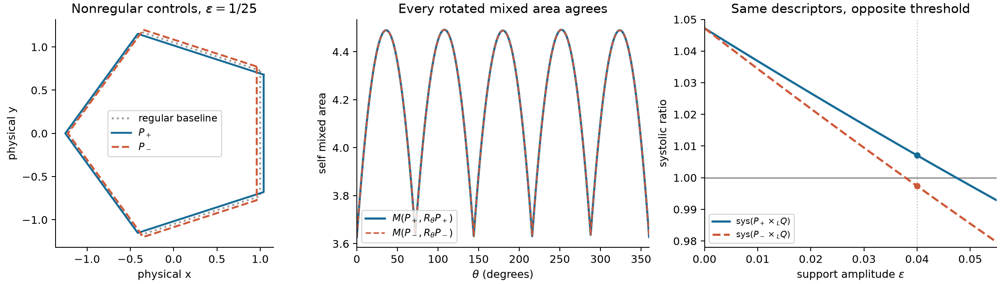

# Complete rotational mixed-area data miss a nonregular above-one transition

17 October 2026. This packet gives an exact obstruction, not a successful general predictor or a new global HKO bound. Two explicitly nonregular pentagons have the same area, perimeter, difference-body area, **every rotational mixed-area profile against the fixed regular partner, and every rotational self mixed-area profile**. One product has systolic ratio **1.0070474868**, the other **0.9973675275**. A second pair has both ratios above one, **1.0155461760** and **1.0079497072**. Consequently even this infinite collection of integrated two-dimensional geometry cannot determine the above-one threshold or the upper-tail ratio. A fifth-order support phase separates the controls.

The capacity input is the existing [equiangular capacity-core theorem](../../../topics/products/pentagon-arbitrary-partner/equiangular-partner-global-20261005.md). The new deduction is a complete mixed-area-profile collision in nonregular near-HKO products and its sharp phase/stability formula. No external novelty claim, held-out score, manuscript promotion or arbitrary-factor bound is made.



## Explicit controls and exact statement

Let $n_i=(\cos(2\pi i/5),\sin(2\pi i/5))$, indices modulo five, and set

$$
 b=\cos(\pi/5)=\frac{1+\sqrt5}{4},\qquad
 \varphi=\frac{1+\sqrt5}{2},\qquad
 \rho_* =\frac{3+\sqrt5}{5}.
$$

Write $P_0=\{x:n_i\cdot x\le1\}$, an inradius-one regular pentagon, and $J(x,y)=(-y,x)$. Fix the regular partner

$$Q=\sin(2\pi/5)\,J P_0.$$

Its relative rotation $\pi/2$ is an HKO angle modulo $\pi/5$. Its scale is chosen solely to simplify the exact arithmetic: $c(P_0\times_L Q)=5$. For $0<\epsilon<1/\varphi$, put

$$
 d_i=\cos(4\pi i/5),\qquad
 P_\pm(\epsilon)=\{x:n_i\cdot x\le1\pm\epsilon d_i\}.
 \tag{1}
$$

Both are genuine convex pentagons throughout this range. Their edge lengths are

$$
 \ell_i^\pm=\frac{2(1-\cos(2\pi/5))\mp\sqrt5\epsilon d_i}
 {\sin(2\pi/5)}>0.
 \tag{2}
$$

They are nonregular and not affine images of a regular pentagon when $\epsilon>0$: an affine image preserving the regular five-direction normal fan must be a similarity. Indeed its projective action preserves cyclic order or reverses it, and the resulting cyclic shift or reflection of the five equally spaced projective directions uniquely determines the corresponding orthogonal map up to scale. Their support offsets cannot become constant by translation and scaling. Equivalently, the deformation lies in the nontranslation Fourier mode two.

For planar mixed area $M$, the following identities hold for **every real $\theta$**:

$$
\begin{aligned}
 A(P_+)&=A(P_-)=A(P_0)(1-b\epsilon^2),\\
 \operatorname{per}(P_+)&=\operatorname{per}(P_-)=\operatorname{per}(P_0),\\
 M(P_+,R_\theta Q)&=M(P_-,R_\theta Q),\\
 M(P_+,R_\theta P_+)&=M(P_-,R_\theta P_-).
\end{aligned}\tag{3}
$$

In particular, $A(P_+-P_+)=A(P_--P_-)$ and every area of every finite nonnegative Minkowski combination of rotated copies of $P_+$ and $Q$ equals the corresponding area with $P_-$ substituted throughout. The combination's coefficients and angles may be arbitrary and need not be selected in advance. This follows by polarizing its area into the matching pairwise mixed areas. The claim concerns these **area-valued** descriptors; it does not say the Minkowski sums themselves or pointwise width functions agree.

Nevertheless,

$$
 \boxed{\begin{aligned}
 c(P_+\times_LQ)&=5(1-\epsilon/2),\\
 c(P_-\times_LQ)&=5(1-\epsilon/\varphi),\\
 \operatorname{sys}(P_+\times_LQ)&=\rho_*\frac{(1-\epsilon/2)^2}{1-b\epsilon^2},\\
 \operatorname{sys}(P_-\times_LQ)&=\rho_*\frac{(1-\epsilon/\varphi)^2}{1-b\epsilon^2}.
 \end{aligned}}\tag{4}
$$

| $\epsilon$ | $\operatorname{sys}(P_+\times_LQ)$ | $\operatorname{sys}(P_-\times_LQ)$ | Consequence |
|---|---:|---:|---|
| $1/25$ | 1.007047486767660 | 0.997367527506987 | Same complete descriptors, opposite sides of one |
| $1/32$ | 1.015546176025205 | 1.007949707150899 | Both above one, unequal ratios |
| $1/100$ | 1.036851522935116 | 1.034393007742172 | Collision persists arbitrarily near HKO |

These are exact analytic/control results, not historical labels or a population frequency. The pair at $1/32$ differs by 0.00759647, about 16.1% of the HKO excess over one. The main conclusion is the whole descriptor-class obstruction, rather than a small numerical change in a bound.

## Proof of all mixed-area identities

For polygons with the same genuine normal fan, support functions depend linearly on the support offsets: on the cone between consecutive normals, the support point is their affine intersection. Consequently there is a continuous homogeneous signed support function $f$ for which

$$h_{P_\pm}=h_{P_0}\pm\epsilon f.$$

This is an identity in the vector space spanned by support functions; $f$ need not itself be the support function of a convex body. Rotating by $2\pi/5$ permutes its five normal values $d_i$. Since $\sum_i d_i=0$, linear interpolation on each common normal cone gives the **pointwise** identity

$$\sum_{k=0}^4 f(R_{2\pi k/5}u)=0\qquad(u\in\mathbb R^2).\tag{5}$$

Equivalently, both Minkowski orbit averages are exactly $P_0$:

$$\frac15\sum_{k=0}^4R_{2\pi k/5}P_\pm=P_0.\tag{6}$$

Mixed area is a symmetric bilinear form on this support-function vector space. If $S$ is any fivefold-rotation-invariant convex body, averaging its pairing with (5) proves $M(f,S)=0$. Every $R_\theta P_0$ and every $R_\theta Q$ has that invariance. It follows that

$$M(P_\pm,R_\theta Q)=M(P_0,R_\theta Q),$$

and expansion gives

$$M(P_\pm,R_\theta P_\pm)
 =M(P_0,R_\theta P_0)+\epsilon^2M(f,R_\theta f).\tag{7}$$

Thus the sign disappears for every angle, proving the last two lines of (3), including $\theta=0,\pi$. The area of a support-offset polygon with consecutive normal gap $\Delta=2\pi/5$ is

$$A(h)=\frac{\sum_i h_i h_{i+1}-\cos\Delta\sum_i h_i^2}{\sin\Delta}.$$

Using $\sum d_i=0$, $\sum d_i^2=5/2$ and $\sum d_id_{i+1}=(5/2)\cos(4\pi/5)$ yields $A(P_\pm)=A(P_0)(1-b\epsilon^2)$. Formula (2), summed over $i$, proves the perimeter identity. Positivity follows from $|d_i|\le1$ and $2(1-\cos(2\pi/5))/\sqrt5=1/\varphi$.

No approximation of a rotational profile is used in this proof. It also proves equality against every fivefold-invariant test body, beyond the fixed regular partner.

## Exact capacity and threshold proof

The five extreme normalized normal closures are the cyclic shifts of

$$\lambda^{(0)}=\frac{(1,1,0,\varphi,0)}{2+\varphi}.$$

This complete closure list and the existing all-angle equiangular capacity-core theorem give

$$c(P_h\times_LQ)=5\min_k\lambda^{(k)}\cdot h.$$

For the deformation in (1), their five loads, as a multiset, are

$$\left\{\frac{3-\sqrt5}{4},-\frac12,\frac1\varphi,-\frac12,
\frac{3-\sqrt5}{4}\right\}.$$

Taking minima with $h=1\pm\epsilon d$ proves the first two lines of (4). Since $\operatorname{sys}(P_0\times_LQ)=\rho_*$ and the factor-area product changes by $1-b\epsilon^2$, it proves the last two lines.

For $\epsilon=1/25$, the two exact ratios are

$$
\frac{7203+2401\sqrt5}{5(2499-\sqrt5)},\qquad
\frac{7308+2300\sqrt5}{5(2499-\sqrt5)}.
$$

The first exceeds one iff $2406\sqrt5>5292$, and the second is below one iff $2305\sqrt5<5187$. Squaring positive quantities verifies both with integers; the checker also compares them directly in the ordered field $\mathbb Q(\sqrt5)$.

## What the missing phase is, and a sharp stability envelope

A general small deformation within the same five-normal fan has, after translation and scale,

$$h_i=1+\epsilon\cos(4\pi i/5+\alpha).$$

There are exactly two remaining support degrees of freedom: the discrete modes one and four are translations, mode zero is scale, and modes two and three give this amplitude and phase. For $0\le\epsilon<1/\varphi$, every phase gives a genuine pentagon. Its five closure responses form a cosine orbit of amplitude $\epsilon/\varphi$. If $\delta\in[0,\pi/5]$ is the distance of that orbit from its negative extremum, then

$$\iota=1-\frac\epsilon\varphi\cos\delta,
\qquad
\delta=\frac15\arccos(-\cos5\alpha).$$

Here the constant phase of the base closure response is $2\pi/5$, whose fifth multiple disappears. Therefore the exact ratio at the HKO partner is

$$\operatorname{sys}=\rho_*\frac{[1-(\epsilon/\varphi)\cos\{\tfrac15\arccos(-\cos5\alpha)\}]^2}{1-b\epsilon^2}.$$

This identifies the phase ignored by all the quadratic profiles. It is not a new cheap universal capacity formula: in this special fan the prior theorem already reduced capacity to five circuit loads.

At fixed amplitude (equivalently fixed area and perimeter), the sharp range is

$$\boxed{\rho_*\frac{(1-\epsilon/\varphi)^2}{1-b\epsilon^2}
 \le\operatorname{sys}\le
 \rho_*\frac{(1-\epsilon/2)^2}{1-b\epsilon^2}.}\tag{8}
$$

Both endpoints are attained by (1). If $D=1-A(P)/A(P_0)=b\epsilon^2$ at the same perimeter, this becomes a sharp square-root stability envelope in $D$. In particular, near HKO the true loss is linear in support amplitude while every matching quadratic profile changes only quadratically. A smooth first-order expansion in those profiles cannot recover that loss. A phase-aware descriptor is required for exact prediction; a profile-only bound must take the envelope over the missing phase.

## Method comparison, verification and limits

[PLAN.md](PLAN.md) records the backward target and alternatives. Mean/full-factor closure mixing yields only the familiar weak $\operatorname{sys}\le2$ route; maximum-area sparse closures duplicate the already stopped minimum-area supporting-triangle selector; circumradius duality repeats the retained fitting representation. These routes did not provide a new HKO-sharp arbitrary-factor inequality and were not expanded. The selected obstruction has a complete proof and directly reaches the upper tail, but it does not settle Jörn's main predictive target.

[verify.py](verify.py) is standard-library-only. It checks six nonregular product controls in $\mathbb Q(\sqrt5)$: support intersections and feasibility; exact areas and the complete five closures; the core values; exact capacity by all 25 support pairs at both imported shadow orders; ratios and the straddling/above-one tests. It uses the symplectic chart $q=T x,p=T^{-\mathsf T}y$, $T=\operatorname{diag}(1,\sin(2\pi/5))$, to put the two factors into the exact coordinates $P_\pm'$ and $JP_0'$. This chart is solely for arithmetic. The all-angle Euclidean profiles in the statement refer to the original common physical plane, and are checked separately there.

The floating geometric check constructs original polygons from adjacent halfplane intersections and evaluates mixed area by the edge-support formula. Across 721 angles for each of three amplitudes, the largest cross-profile discrepancy is $8.89\cdot10^{-16}$ and the largest self-profile discrepancy $1.78\cdot10^{-15}$. The pointwise orbit-average identity is separately checked in 113 directions, and the general phase formula against all five circuit loads at 113 phases. These grids check conventions, not the universal all-angle proof. [verification.json](verification.json) retains exact coordinates, algebraic results, physical coordinates, arithmetic scope and the checker hash.

Reproduce from this checkout without downloads:

```sh
python3 -B patterns/upper-tail/mixed-area-global/verify.py \
  --out /tmp/msc-math/upper-tail-20261017/mixed-global/replay.json
```

The figure can be regenerated with `uv run --offline --with matplotlib python patterns/upper-tail/mixed-area-global/plot.py --directory patterns/upper-tail/mixed-area-global`.

Inspected sources: repository/agent entry points and collaboration rationale; product topic account; two-shadow theorem; conditional-coupling and signed-prefix reports; upper-tail route triage and prior min-triangle/full-partner reports; fixed-pentagon symmetric-partner proof; equiangular theorem and its full capacity-core proof. Focused searches found no same rotational-profile collision in these sources; this is a bounded local comparison, not an exhaustive literature novelty assessment. The figure was rendered with the existing offline-cached Matplotlib environment and visually inspected. No capacity producer, large cohort, optimizer, network action or manuscript edit was used.

Receiving owner `/root` owns final retention, gallery integration and commit. Independent mathematical and exact-text review is recorded below.

[review: /root/review_mixed]
