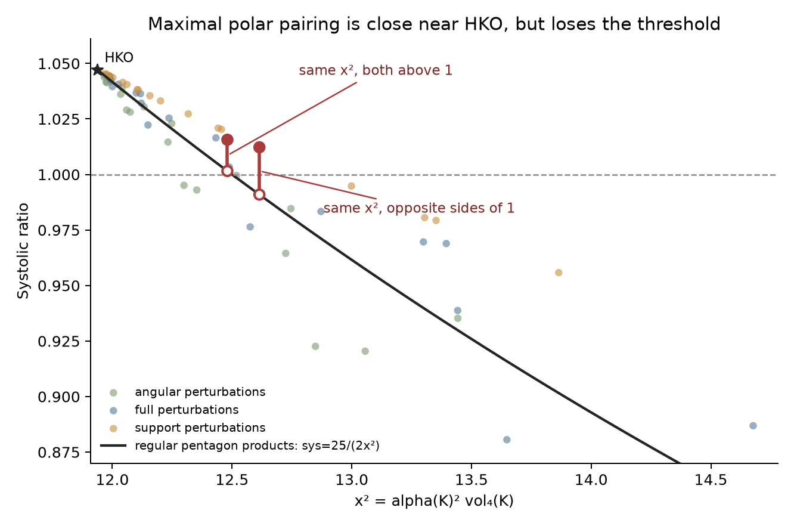

# Maximal polar symplectic pairing: a useful near-HKO proxy with an exact upper-tail obstruction

**Two bodies have exactly the same normalized maximal polar symplectic pairing, while one has systolic ratio below one and the other above one.** Their ratios are 0.9909422567… and 1.0122477376…; the exact gap exceeds 1/50. Another pair has both ratios above one, 1.0015604257… and 1.0156459534…, with exact gap greater than 1/100. The rational nonregular inputs and independent capacity checks are retained below. These refute a universal function of this single scalar, including a perfect above-one classifier. They do not refute a predictor using it jointly with other geometry.

The corresponding HKO-calibrated formula nevertheless transfers well to the 60 independently frozen nonregular product challenges: median relative ratio error 0.54%, 90th percentile 3.97%, maximum 5.67%. It does not solve the broad held-out-tail problem, and no new global bound or conjectural global maximality proof survives this lane.



## Candidate, invariance and imported mathematics

For a full-dimensional convex body K in R⁴, let g be its volume centroid and L=K−g. Define

\[
 \alpha(K)=\max_{u,v\in L^\circ}|\omega_0(u,v)|,
 \qquad X(K)=\alpha(K)\sqrt{\operatorname{vol}_4(K)},
 \qquad M(K)=\operatorname{vol}_4(K)\operatorname{vol}_4(L^\circ).
\]

For a polytope given by a_i·x≤1, the centered polar vertices are b_i=a_i/(1−a_i·g), so alpha=max_ij |omega(b_i,b_j)|. The bilinear maximum is attained at vertices by taking a maximum of linear functionals twice. Translation and dilation leave X and M unchanged; symplectic linear maps leave X unchanged because omega(S⁻ᵀu,S⁻ᵀv)=omega(u,v) and det S=1. General affine maps leave M unchanged. Thus these are geometric features, with no target capacity or optimizer used in construction.

The repository's [HK convention](../../../topics/capacity-and-qp/proofs/hk2017-qp-conventions.tex) gives c=1/(2Qmax). Since Q≤alpha·sum_(i<j) beta_i beta_j≤alpha/2, it gives the elementary **lower** bound c≥1/alpha. This supplies no upper bound needed for global maximality. It also identifies the omitted issue: the greatest polar coefficient need not receive the closure weights and ordering needed for the greatest action objective.

For the circumradius-one regular pentagon let h=cos(pi/5), w=1+h, and S₅=(5/2)sin(2pi/5). The existing [independently affine pentagon theorem](../../../topics/products/pentagon-affine-products/README.md) gives c=w²/m(G⁻¹H⁻ᵀ). Its factors have centroid zero, alpha=m/h², and w²=5h². Therefore

\[
 \boxed{c=5/\alpha,\qquad \operatorname{sys}=25/(2X^2)}
\]

on that entire established affine family. This is an imported consequence, not a new capacity formula. Testing transfer to nonregular bodies is the new experiment.

Purely affine invariants such as M already have a separate exact obstruction: P₅×R_theta P₅ are volume-preserving linearly equivalent for all theta, yet their known ratios range from (5+2sqrt(5))/10 to (3+sqrt(5))/5, a gap exactly 1/10 across one. This applies to all affine-only shape descriptors; it does not apply to X, which sees the relative symplectic position.

## Exact obstruction at and above one

Both retained rational fixtures are genuine five-facet planar factors, hence ten-facet Lagrangian products. [exact_counterexample.py](exact_counterexample.py) reconstructs every rational planar vertex and the exact area centroid, normalizes all polar covectors, takes the complete maximal-pair coefficient, and independently checks capacity by all **25 factor-closure pairs × 120 cyclic words = 3,000 exact HK evaluations per body**. It does not use the other lane's two-angular-word oracle internally. Coverage imports the established [six-facet product reduction](../../../topics/products/product-qp-six-facet-reduction.tex); it is not a new proof of that theorem.

| Rational nonregular body | Exact-rational X², decimal | Its exact-rational ratio, decimal | Same-X regular product ratio, decimal | Exact separation |
|---|---:|---:|---:|---|
| `contact_support_s1_e3of100` | 12.614256699690529 | 1.0122477376477583 | 0.9909422566536693 | >1/50; straddles one |
| `contact_full_s3_e3of100` | 12.480525067389072 | 1.0156459533798117 | 1.0015604257437707 | >1/100; both above one |

Full rational numbers and normal presentations are in [exact-threshold-counterexample.json](exact-threshold-counterexample.json) and [exact-counterexample.json](exact-counterexample.json). These examples were selected after the frozen blind evaluation as exact counterexamples, not presented as another blind test.

**Existence and exact equality of the regular comparator.** For each fixture put r=25/(2X²). The integer/rational verifier checks 49/50<r<26/25. The regular rotation ratio ranges continuously from a=(5+2sqrt(5))/10 to b=(3+sqrt(5))/5, and a<49/50<26/25<b (use sqrt(5)<12/5 and sqrt(5)>11/5). Therefore there is theta in (0,pi/10) with

\[
 \cos^2\theta= X(K)^2 h^4/S_5^2.
\]

For L=P₅×R_theta P₅, the centered polar norm is alpha(L)=cos(theta)/h² and volume S₅². Hence X(L)²=X(K)² **exactly**, and its known ratio equals r. The displayed inequalities and the two capacity computations are rational checks; rounded decimals do not establish the collision. This argument produces an algebraic comparator even though an angle is used to describe it. The first gap is about 45% of the known HKO excess over one, rather than a tiny improvement of a bound.

## Frozen empirical test

The [plan](PLAN.md) was written before scores. It compared affine volume-product geometry, the centered polar norm, translation-optimized polar norm and full action optimization. Raw pooled R² wrongly rewards degenerating bodies; tail rank alone ignores calibration; elegance can reward irrelevant low-ratio theorems. The chosen rubric combined bulk and within-bucket tail prediction, blind nonregular transfer, invariance, simplicity and a plausible bound implication. Full action optimization was rejected as a predictor because it repeats capacity computation. Existing width, moment, inscribed-core and closure-selector packets were read as stopped or separate routes, not rerun.

All six prescribed models fit log(sys) from log X and/or log M, using degree-one or complete degree-two polynomials. No model was added after the scores. The source population is the verified 4,096 generic bodies in F=5…12 and 10,240 products in 3≤k≤m≤6. Each exact generator bucket is held out in turn. Upper tails contain ceil(10% of each bucket), 1,446 total, selected by historical ratio only after prediction. The pooled-tail R² uses the pooled tail mean; it does not assert a negative R² in every bucket. Name-SHA256 modulo-five holdout, generic/product transfer, per-bucket scores, rank and decile recall are in [results.json](results.json).

| Frozen model | Bulk log R² | Pooled upper-decile log R² | Tail median relative error | Tail 90th percentile |
|---|---:|---:|---:|---:|
| log X linear | .9461 | −.5913 | 13.44% | 31.84% |
| log X quadratic | .9563 | −.3510 | 11.54% | 26.40% |
| log M linear | .2194 | −39.0054 | 56.14% | 74.77% |
| log M quadratic | .2244 | −39.2236 | 57.45% | 76.26% |
| log X + log M linear | .9534 | −.3250 | 11.69% | 30.41% |
| log X + log M quadratic | .9642 | −.4746 | 11.64% | 26.70% |

Polar models recover about 64% of each bucket's top decile on average. On the common 14,334 rows with an existing ridge-table name join, ridge-only quadratic gives bulk log R²=.9529, pooled-tail −1.8761 and tail median error14.10%; [baselines.json](baselines.json) contains uniformly matched rows and the constant baseline. The two absent ridge joins are the preexisting covariance exclusions; the main polar analysis retains all14,336. The polar feature improves this limited ridge-only comparison but fails the stronger target of explaining the selected tail.

### Independent nonregular near-HKO challenge

The separate contact lane froze 60 rational bodies from five new SHA256 directions, full/support/angular perturbations, and scales .003,.01,.03,.08. Geometry was frozen before any oracle labels. The six fitted predictions were fixed at SHA256 `9afc08272e9e179eb9274a59680c9b28ebfd8e80733e343b823c4e7125367b06`. The mechanistic c=5/alpha control was frozen **after inspecting retained-data scores but before receiving fresh truth**, SHA256 `d4495a37a5761a88adf1bf05b023ad777c503a5b2ca5856e20783d584d3d1b0e`. It was chosen for its existing exact affine theorem, not fitted to these60 labels. The oracle then supplied exact rational capacity and exact rational product volume; 41 bodies have ratios above one.

| Model | Fresh median relative error | Fresh 90th percentile | Fresh maximum | Log R² | Above-one recall/precision |
|---|---:|---:|---:|---:|---:|
| log X linear | 16.44% | 19.46% | 24.63% | −13.210 | 41/41; 41/60 |
| log X quadratic | 7.76% | 8.05% | 8.08% | −2.164 | 0/41; no positives |
| log M linear | 38.73% | 39.69% | 39.83% | −128.537 | 0/41; no positives |
| log M quadratic | 18.07% | 19.34% | 19.53% | −19.147 | 0/41; no positives |
| log X + log M linear | 2.30% | 4.86% | 9.24% | .445 | 41/41; 41/49 |
| log X + log M quadratic | 18.13% | 18.76% | 20.12% | −20.996 | 0/41; no positives |
| **Unfitted c=5/alpha** | **.54%** | **3.97%** | **5.67%** | **.789** | **40/41; 40/42** |

The last rule's rank correlation is .9658. On the41 truly above-one bodies its maximum ratio error is2.10%. A constant HKO reference has median relative error1.90%, maximum18.93%; proximity alone explains part of any good score. More revealingly, c=5/alpha captures between .588 and1.635 of the true loss from the HKO ratio. For support-only perturbations it systematically captures1.59–1.64 times the loss. Thus small ratio error does not establish the correct first-order mechanism. [blind-results.json](blind-results.json) retains every prediction/error and exact-truth identity.

## Centering diagnostic and stop decision

The prescribed bounded diagnostic optimized the center on eight SHA-ranked bodies per bucket,144 total, by maximizing t subject to t≤log(1−a_i·c)+log(1−a_j·c)−log|omega(a_i,a_j)|. These define a convex feasibility problem with a concave right side. The first unscaled SLSQP implementation had three failures; it was replaced by a whitened, analytic-Jacobian implementation. All144 then reached numerically feasible successful terminations, maximum constraint deficit8.74e−12. Alpha decreased by median factor1.488, and numerical c·alpha ranged3.536…–5.552…. These are optimizer diagnostics, not exact optimality certificates or new predictive scores. No broad scan or new regression was authorized on this basis; this route stopped.

Even the attractive general bound c≤5/alpha_optimized is false: for P={x≥−1,y≥−1,x+y≤1}, the known exact product ratio is1/2 and c(P×P)=9/2. Its three normalized polar covectors are (−1,0),(0,−1),(1,1). For any two factor origins, the positive denominators x_i,y_i sum to3 each. The diagonal dot products1,1,2 force alpha≥(2+sqrt(2))²/9 by Cauchy–Schwarz; equality is attained with x_i=y_i proportional to (1,1,sqrt(2)). Therefore min_center alpha·c=3+2sqrt(2)>5. This is a secondary low-ratio control, not the upper-tail result.

**Disposition:** retain the exact single-invariant upper-tail obstruction and the fully frozen test. Use c=5/alpha only as a descriptive near-affine-pentagon baseline. Do not deepen bulk regression, regular-product sampling or center optimization without a new mechanism addressing closure mass and coherent order. No universal global-maximality conjecture follows from these measurements.

## Inputs, checks and reproduction

Inspected: this checkout's README/AGENTS/rationale, task targets and gallery, empirical dataset/table contracts, retained feature/product packets, current upper-tail stopped-route reports, six-facet reduction and affine-pentagon theorem. This was a focused source audit, not an exhaustive literature search or novelty review. The registered source cache was verified offline. Source SHA256 identities are `a21ac62ba5c9496ef631d3cce74e8b663764516b76e9d4725f1e517d8dd55f9f` (generic) and `66bf82010e92e0f26b0df226f4e6c0eef05d21eb22a0967c7f669530f6545736` (products); snapshot `f7bc6be841e9d30741d5bf7ec8d4f0c0c74ec22745d3325b792e64cec333ca96`. Historical capacities/sys remain historical numerical labels; the two exact fixtures and separate fresh oracle have different, explicit evidence contracts.

The 14,336 numerical centroid/volume reconstructions differ from source volume by at most4.76e−14 relative. Translation, dilation, symplectic shear/stretch and general-affine Mahler checks on six source bodies give maximum normalized-alpha error1.56e−15 and Mahler error1.78e−15 ([verification.json](verification.json)). Main geometry/model calculation took about14 seconds; each exact fixture verifier takes about0.14 seconds on this workstation. No capacity/volume producer, remote computation or reset was run. Figures were rendered and visually inspected. Account spending remains unmeasured.

The exact upper-tail obstruction checks need Python's standard library only and read the self-contained certificates:

```bash
python3 patterns/upper-tail/polar-geometry/exact_counterexample.py \
  --certificate patterns/upper-tail/polar-geometry/exact-threshold-counterexample.json \
  --out /tmp/msc-math/upper-tail-threshold-check.json
python3 patterns/upper-tail/polar-geometry/exact_counterexample.py \
  --certificate patterns/upper-tail/polar-geometry/exact-counterexample.json \
  --out /tmp/msc-math/upper-tail-above-one-check.json
```

Numerical reproduction uses NumPy/SciPy; the figure additionally Matplotlib. `analyze.py --repo <checkout> --source <verified-cache/files> --challenge <frozen-sample.json> --out <scratch>` writes only the chosen scratch directory and pins the adjacent PLAN.md. Source geometry features and held-out predictions are retained in compressed tables. The contact challenge/oracle hashes in the frozen files identify the independent inputs; changing them would be a different test. Scientific proof review and user-visible delivery review are owned by the root coordinator.

[review: /root/review_spectra]
