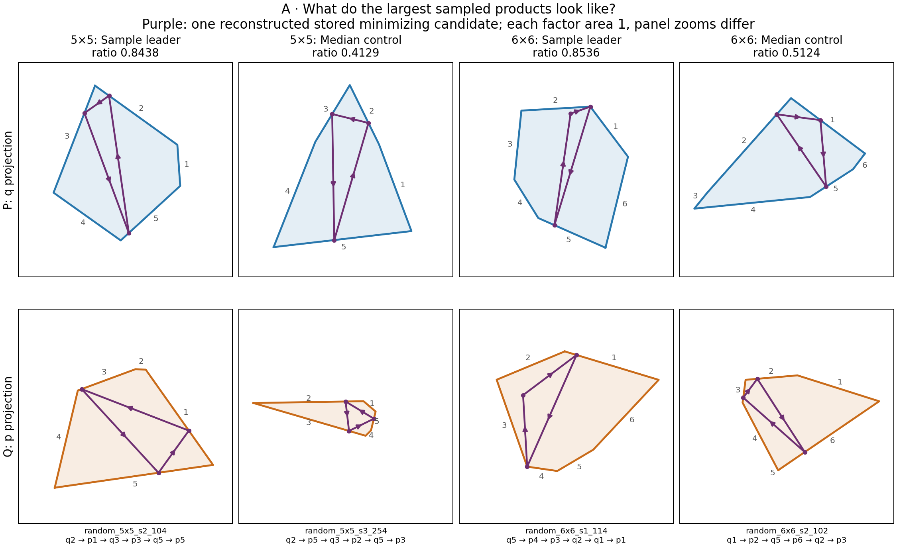
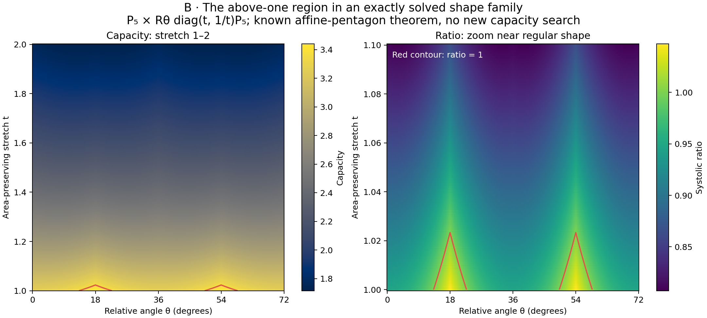
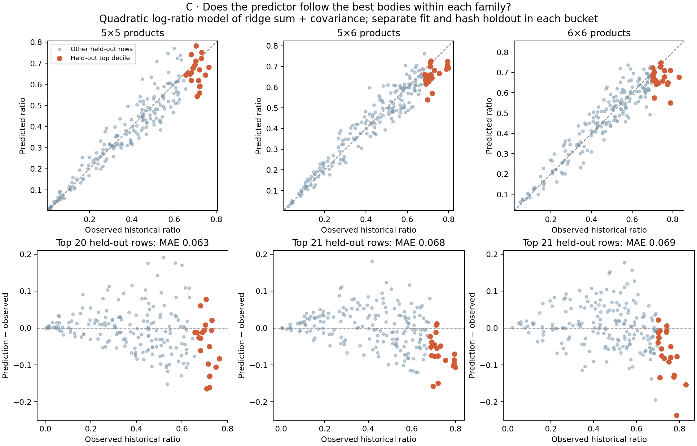

# Three figures for explaining the upper tail

Open [the local gallery](index.html). These are reader-facing alternatives for feedback, not three additional research claims. Each has a PNG, a PDF, numerical data and a common [reproduction script](figures.py). No capacity or volume producer was run.

| Figure | What a reader can learn | What it cannot establish |
|---|---|---|
| A: shapes and stored orbits | What two sampled leaders look like beside ordinary products from the same generator bucket | A universal near-maximizer motif, uniqueness of the orbit, or an above-one construction |
| B: stretch versus relative angle | How a known exact capacity formula responds to a declared shape deformation | A new theorem or a statement about arbitrary polygon products |
| C: within-family errors | Where a successful bulk predictor misses the largest ratios even with family-specific training | Impossibility of a different predictor, or prospectively validated prediction |

**Selection comparison.** For an upper-tail explanation, C is the strongest lead: it directly displays the failure that needs explaining. B is strongest for a geometric mechanism in a solved family. A is strongest for making the objects concrete. Appearance alone would overvalue A; theorem strength alone would overvalue the already-known B; pooled prediction R² would conceal C's tail error. All three are shown so feedback can change this provisional editorial choice cheaply.

## A · Sample leaders beside median controls, with actual orbit projections



For each of the 1,024-row 5×5 and 6×6 buckets, show its largest recorded ratio and the body at sorted index 512 (zero based), a median control. Both factor polygons are translated and individually scaled to area one; panel zooms differ. Purple curves are the q and p projections of a reconstructed phase-space orbit, and arrows follow time. Gray numbers label facets; the word under each column uses those factor-local, one-based labels.

The cache stores one returned minimizing word and its action, but no weights. The script solves the fixed word's KKT linear system, reconstructs its breakpoints using the repository's orbit-recovery convention, and checks positive weights, normalization, closure, active facets, all polygon halfspaces and action agreement. All residuals are below 10⁻¹⁰ (observed maximum below 6×10⁻¹⁵). This is a numerical consistency check of one stored candidate, not a new global capacity computation, proof of minimality or orbit-completeness result. The plotted ratios remain the historical numerical targets with numerical volumes. Same-factor consecutive facets in the word can form one billiard block.

[PDF](A-shapes-orbits.pdf) · [raw shapes, word, weights, breakpoints and residuals](A-shapes-orbits.json) · [stored-word limitation](../features/REPORT.md#3-stored-orbit-words-cannot-establish-an-extremal-motif)

## B · Capacity as a function of shape and relative angle



Fix the circumradius-one pentagon P₅ with outward facet normals nᵢ=(cos(2πi/5), sin(2πi/5)). The displayed family is P₅ × Rθ diag(t,1/t)P₅, with 1≤t≤2 and 0°≤θ≤72°. The deformation preserves both factor areas. The left map shows capacity on the full stretch range; the right zooms to 1≤t≤1.1 and shows the ratio. Red contours mark ratio one. Each pixel evaluates the **already proved affine-pentagon formula**, in floating point for display:

    M = Rθ diag(1/t,t)
    c = (1+cos(π/5))² / maxᵢⱼ |nᵢᵀ M nⱼ|
    sys = c² / (2 area(P₅)²),  area(P₅) = (5/2) sin(2π/5).

The known sharp affine-class maximum is (3+√5)/5 ≈ 1.04721; it is attained here at t=1, θ=18° or 54°. The map illustrates how quickly this specified stretch leaves the above-one region. It does not cover every independent affine deformation as a parameterization, and the plotted grid is not the proof of the maximum. No new capacity theorem is claimed.

[PDF](B-stretch-angle.pdf) · [full grid in NumPy NPZ format](B-stretch-angle.npz) · [existing theorem and proof, Sections 1 and 5–6](../../topics/products/pentagon-affine-products/research.tex)

## C · Within-family prediction errors, emphasizing the largest ratios



Fit the existing quadratic model in log(ridge sum R) and log(covariance eccentricity ρ), now **separately inside each exact generator bucket**. A deterministic representation-hash split trains on approximately 80% and holds out approximately 20% of each bucket. Orange points are the largest ceil(10% × held-out count) observed ratios among that bucket's held-out rows. The diagonal and zero line indicate perfect prediction. The lower panels use a common error scale.

| Bucket | Training / held out | Held-out MAE | Top-decile count | Top-decile MAE | Top-decile median prediction − observed |
|---|---:|---:|---:|---:|---:|
| 5×5 | 824 / 200 | .045 | 20 | .063 | −.027 |
| 5×6 | 815 / 209 | .043 | 21 | .068 | −.070 |
| 6×6 | 814 / 210 | .047 | 21 | .069 | −.056 |

The upper tail remains systematically underpredicted in these three buckets despite family-specific training. This is a concrete limitation of this model on retained targets, not a theorem excluding better features or models. It motivates asking which geometric information the successful bulk summaries lose. The [existing moment obstruction](../features/REPORT.md#1-exact-moment-obstruction-and-first-angular-information) supplies one exact example of lost angular information.

The polynomial basis is fixed from the retained combined model: 1, log R, log ρ, (log R)², log R log ρ, (log ρ)²; ordinary least squares predicts log(sys). Test rows satisfy int(poly_id[:8],16) mod 5 = 0. The full computation covers 14,334 common rows in 18 buckets, including 2,877 held-out rows; the plot selects the three product buckets with both factors having at least five sides. Two covariance exclusions remain explicit in the JSON. This new within-family protocol differs from both leave-bucket-out and the earlier pooled hash-holdout model, so their scores should not be compared as if the training task were identical. It is a retrospective visualization, not a prospectively frozen proposer test.

[PDF](C-within-family-errors.pdf) · [all held-out rows, gzip CSV](C-heldout-predictions.csv.gz) · [all 18 buckets, coefficients and protocol](C-within-family-errors.json)

## Reproduction and evidence identity

Source checkout at generation: branch `codex/patterns-2026-10-17`, HEAD `d19e1477005b1eb9136f4ee6aad1b23ced1c798a`. [verification.json](verification.json) pins the input hashes and records the checks. The shared polytope source is registered snapshot `f7bc6be841e9d30741d5bf7ec8d4f0c0c74ec22745d3325b792e64cec333ca96`; no download or package installation occurred.

From this worktree, with NumPy, SciPy and Matplotlib already installed:

```sh
OPENBLAS_NUM_THREADS=1 python patterns/visual-options/figures.py \
  --repo "$PWD" --out /tmp/msc-math/thesis-owner/reproduce-visual-options
```

This run used `/home/joern/.cache/uv/environments-v2/plot-top-shapes-5d71123466e61d07/bin/python`. The script writes only its output directory. A reads retained product features and the registered source/cache; B reads no target data; C reads the pinned covariance and geometry tables. The proof and recovery source identities are also recorded. Inspected sources were the repository README/artifact contract, the product-shape and feature reports/scripts, the affine-pentagon theorem and orbit-recovery/KKT source; this is no exhaustive repository or literature search.

[review: /root/owner_review]
