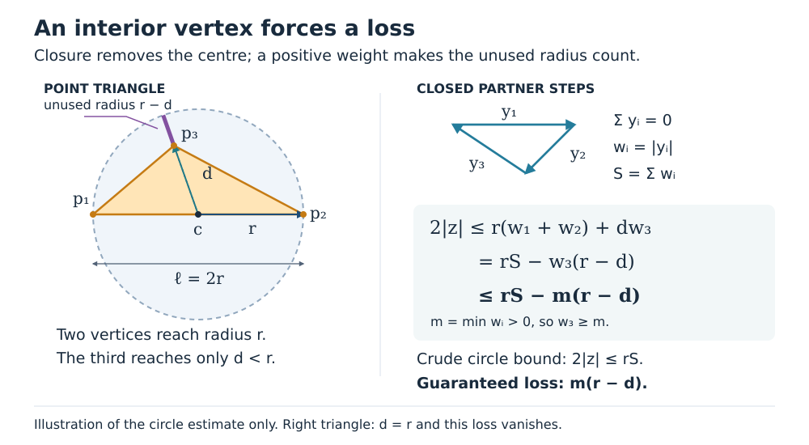

# Why a circle estimate can improve

Let the closed partner steps be complex numbers yᵢ with Σyᵢ=0. For the
matching point triple p=(x₁,−x₃,0), the coefficient satisfies

\[
2z=\sum_i p_i\overline{y_i}
   =\sum_i(p_i-c)\overline{y_i}.
\]

Choose c as the midpoint of the obtuse triangle's longest side ℓ. The two
endpoints have radius r=ℓ/2; after relabelling, its third vertex has radius d<r.
The triangle inequality weights these three radii by wᵢ=|yᵢ|. If S=Σwᵢ and
m=min wᵢ>0, the third vertex therefore saves at least m(r−d):

\[
 2|z|\le rS-m(r-d).
\]

The bound for |z| itself is half this expression. Which partner step weights
the interior vertex may change with the order; the common lower bound m makes
the estimate hold in every order. If the point triangle is right, d=r and
this particular deficit vanishes. An acute triangle uses a circumcircle instead.

This diagram illustrates the geometric estimate preceding the scalar polynomial
bounds; it does not replace them. The [full proof](odd-regular-angular-width.md#1-shape-sensitive-circle-deficit-all-orders)
and its [first](odd-regular-angular-width-audit.md) and
[second](odd-regular-angular-width-second-audit.md) audits supply the complete
all-odd result and its scope. Human proof acceptance, publication novelty and
an independent-affine extension remain open.

Prepared 19 October 2026. The diagram deliberately uses a nonregular obtuse
triangle to emphasize the reusable geometric estimate.
